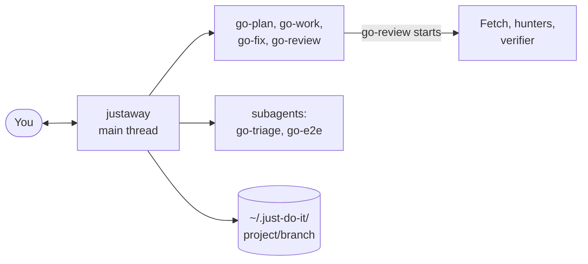

# just-do-it

A manager that plans, builds, tests and reviews a ticket with subagents. The process lives here; the rules come from your repo (`AGENTS.md`, `CLAUDE.md`, project skills).

## Install

```text
/plugin marketplace add le0u0/le0u0.ai
/plugin install just-do-it@le0u0.ai
```

## Use

```text
/just-do-it:justaway on
```

| Step | What happens |
| --- | --- |
| Describe the work | The manager assigns subagents, runs the rest, checks results, reports briefly |
| Done | `/just-do-it:justaway off` |
| One job only | Call any skill alone; `go-*` skills return results in the reply and write no files |

## Manager



| Where | Runs | Model |
| --- | --- | --- |
| Main thread | `go-plan`, `go-work`, `go-fix`, so it can ask you questions | your session's |
| Main thread | `go-review`, which starts its own agents | Fetch haiku low, hunters sonnet medium, verifier opus medium, recheck haiku low |
| Subagent | `go-e2e` | sonnet medium |
| Subagent | `go-triage` | haiku low |

| Also | Detail |
| --- | --- |
| Announces | Model and effort per subagent; tell it a preference and it uses that |
| Saves | Every returned document in `~/.just-do-it/{project}/{branch}/` |
| Docs | [Architecture](docs/architecture/ARCHITECTURE.md); one doc per skill in [`docs/`](docs/), such as [`docs/go-review.md`](docs/go-review.md) |

## Skills you call

| Skill | Job |
| --- | --- |
| `dev-tdd` | Test-first loop over `go-ut` and `go-e2e` |
| `to-pr` | PR title and body |
| `to-test-md` | Manual testing guide as Markdown |
| `to-test-html` | QA page built from that guide |
| `to-charsiu` | Restate the last message in plain language |

`to-*` skills never run on their own.

## Credits

| Skill | Follows |
| --- | --- |
| `dev-tdd` | Matt Pocock's [tdd](https://github.com/mattpocock/skills/tree/main/skills/engineering/tdd) skill |
| `to-pr` | Matt Pocock's [pr](https://github.com/mattpocock/skills/tree/main/skills/engineering/pr) skill |
| `go-e2e` | lackeyjb's [playwright-skill](https://github.com/lackeyjb/playwright-skill) |
