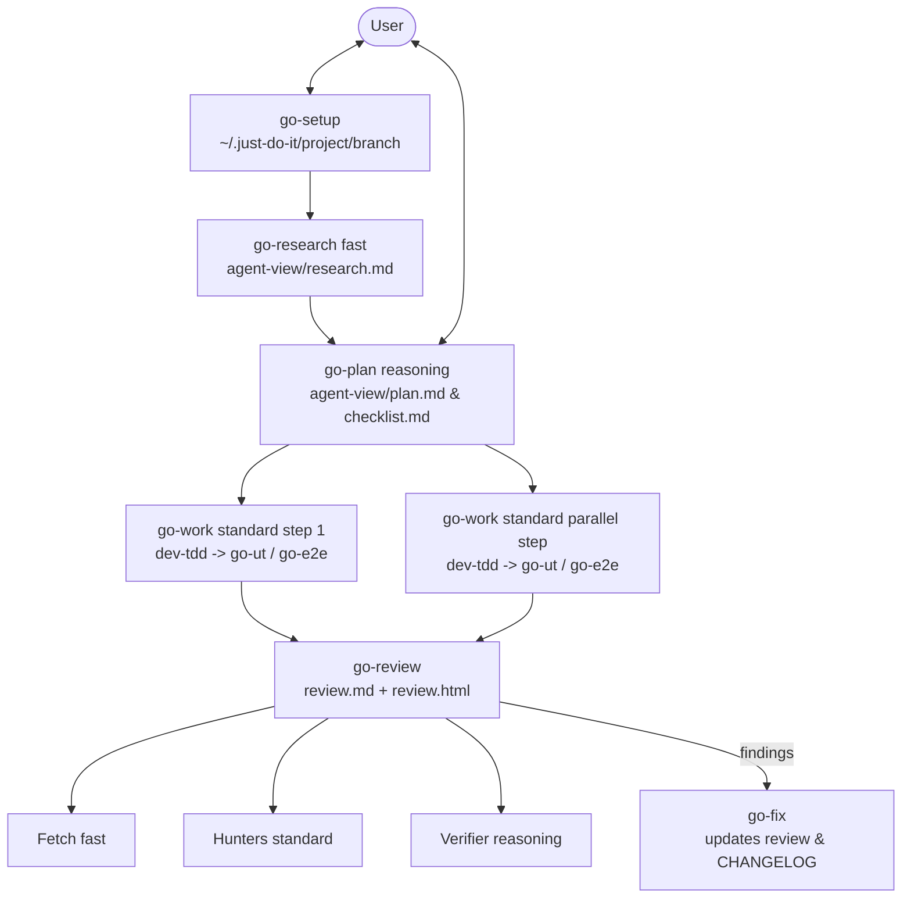

# Architecture

## Independent Skills & Shared Storage

Every skill is independent and writes directly to `~/.just-do-it/{project}/{branch}/` (`agent-view/`, `dev-view/`, and project-level `public/`). If the branch folder is missing, any skill automatically triggers `go-setup` to confirm `{project}` with the user and create the directory structure.

`go-flow` is a stateless pipeline skill that chains the independent skills in order (`go-setup` → `go-research` → `go-plan` → parallel `go-work` → `go-review` → `go-fix`) or runs any user-selected subset of steps.

## Storage views

- **`public/` (`~/.just-do-it/{project}/public/`):**
  - `glossary.md`: created/updated on demand whenever any skill encounters unknown domain or product terms and confirms them with the user.
  - `adr/`: created/updated on demand (`NNN-short-title.md`) when hard-to-reverse decisions are confirmed in `go-plan` or `go-work`.
  - `test-config.md`: created/confirmed on demand when a skill needs to handle tests (`go-ut`, `go-e2e`).
- **`agent-view/` (`~/.just-do-it/{project}/{branch}/agent-view/`):**
  - `research.md` and `attachments/{ticket}/` (`go-research`)
  - `plan.md`, `checklist.md`, `commit-format.md`, `diagnose.md` (`go-plan`, updated by `go-work` and `go-fix`)
  - `CHANGELOG.md` (`go-work`, `go-fix`)
  - `ut.md` (`go-ut`) and `e2e.md` (`go-e2e`)
  - `review.md` (`go-review`, linking `[ut.md](ut.md)` and `[e2e.md](e2e.md)` under `## Tests`)
- **`dev-view/` (`~/.just-do-it/{project}/{branch}/dev-view/`):**
  - `research.html` (`go-research`, visual brief with inline downloaded attachment images)
  - `plan.html` (`go-plan`, visual plan with statechart diagram and attachment images for user approval)
  - `review.html` (`go-review`, interactive review findings with UT and E2E pass/fail badges)
  - `testing-guide.html` (`to-test-doc`, default HTML QA page; or `testing-guide.md` when `.md` is requested)
  - `pr.md` (`to-pr`, always `.md`) and `handoff.md` (`to-handoff`, always `.md`)

[Storage layout](../../skills/go-setup/references/storage.md) · [Public docs](../../skills/go-setup/references/public-docs.md) · [Host mapping](../../skills/go-flow/references/agents.md#host-mapping) · [Scheduling](../../skills/go-flow/references/reuse.md#parallel-steps) · [Review agents](../../skills/go-review/references/agents.md)
