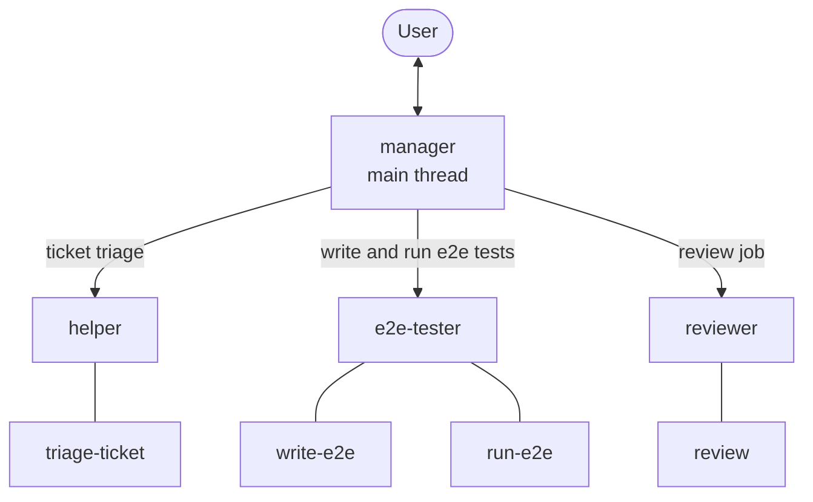
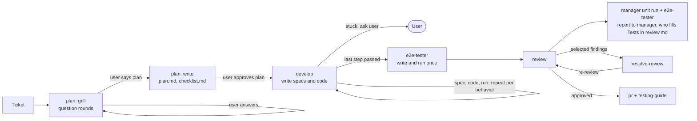
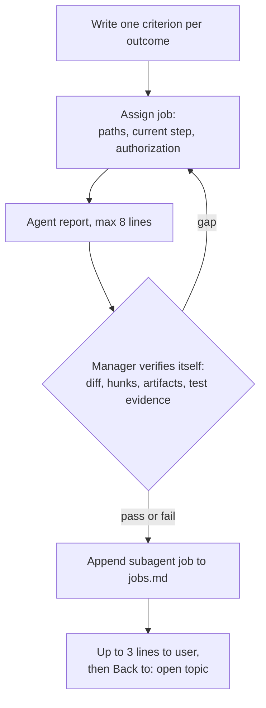

# Architecture

## Agents and skills

`manager` runs in the main thread. It runs `plan` itself, since planning needs the user, and runs `develop`, `resolve-review`, `pr` and `testing-guide` itself, and assigns the other jobs to a subagent of one of three roles, each with its own model and effort. A subagent does its job with the skills the manager names. Only roles carry role names; skills are named by action.

## Ticket flow

## Manager loop

## Why this structure

- **Small handoffs.** Subagents start as general-purpose agents, never as a fork of the main thread, and receive paths only. `state/context.md` holds the rule files and comparable specs the manager found, so later agents skip the search.
- **Fewer agents, fewer re-reads.** Each new agent re-reads rules, plan, and diff. Earlier, one plan step started about four agents: developer, spec writer, and two runners. Now the manager writes the unit specs and code for a step and runs the specs itself, and `e2e-tester` writes and runs the e2e specs once, before review.
- **The manager develops.** A plan step runs in the main thread, so a 12-step ticket starts no developer agent. `checklist.md` carries progress between steps. Trade-off: the main thread's context grows over the ticket, and it runs on the session's model instead of sonnet medium. Within a ticket, other agents stay alive and get later work by SendMessage to the same ID, so a re-test or re-review does not re-read the rules, plan, and diff. Finished agents cost nothing while idle. The manager records each ID in `jobs.md`; if an agent is gone, it starts a fresh one that reads the plan, `checklist.md`, and `jobs.md`.
- **Plan approval is the gate.** With per-step commits, approving the plan approves every step, its one-line commit message, and the file deletions in `Deletions`. `plan` confirms a checkable `Goal` with the user, and only the user's requirement change alters it. `develop` keeps working until the goal holds. It stops and asks only after three different fixes fail, when a step needs an unlisted deletion or a change outside the plan, or when the plan is unclear.
- **The test author runs the test.** The manager writes unit specs test-first, one behavior at a time, and runs them in the same loop; for a review it runs them and reports to the manager, who writes the result into `review.md`. `e2e-tester` writes and runs the e2e specs, so QA owns QA tests. Runs cover only the specs the task changed; other specs that may be affected are reported, not run.
- **Plugin files live outside the repo.** Each project gets one folder, `~/.just-do-it/{project}/`, holding its glossary and ADRs in `docs/` and one folder per branch with its plan, checklist, review, PR text, commit format, `state/` and `attachments/`.
- **Reviewer reuse.** The same reviewer re-reviews the ticket and updates `review.md` in place. Trade-off: a re-review carries its earlier findings, so it is less independent than a fresh read.
- **Manager verifies, not trusts.** An agent's "done" is a claim. The manager checks the diff, artifacts, and test result itself before reporting.
- **Short reports.** Agents report in at most eight lines; the manager announces a job in one line and reports it in at most three. Detail on subagent jobs lives in `state/jobs.md` in the branch folder; the manager's own jobs are tracked in `checklist.md` only.
- **Model by role.** The manager sets `model` and `effort` per role on each start and announces them; the user can override. See [agents.md](../../skills/manager/references/agents.md).
- **Claude Code first.** Subagents work only in Claude Code. Skills stay plain `SKILL.md` files, so other hosts run them directly on the chat's own model, with no subagents.
