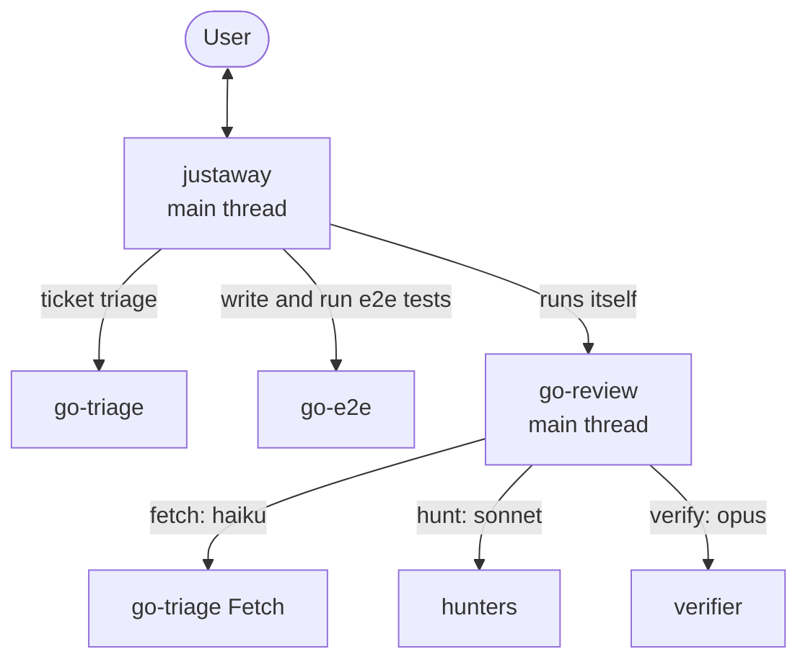
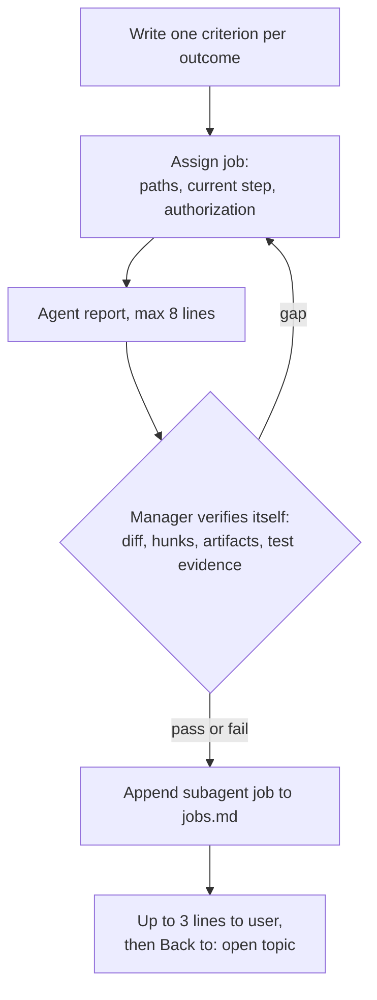

# Architecture

## Agents and skills

| Who | Does |
| --- | --- |
| `justaway` | Runs in the main thread |
| `justaway` | Runs `go-plan` (needs the user), `go-work`, `go-fix` and `go-review` itself; `go-review` starts its own review agents |
| Subagent | Other jobs go to a subagent running one skill, with the model and effort `agents.md` sets |
| Skills | Return results in the reply. Only the manager saves docs |
| `to-*` skills | User-invoked. The manager never runs them |

## Ticket flow

## Manager loop

## Why this structure

### Handoffs

| Topic | Rule |
| --- | --- |
| Subagents | General-purpose agents, never forks. They get only the text or paths the job needs |
| Unit specs | The manager writes and runs them per step through `go-work` |
| e2e specs | `go-e2e` writes and runs them once, before review |
| Reports | Agents report in at most eight lines. The manager announces a job in one line and reports in at most three |
| Job detail | Subagent job detail: `state/jobs.md`. The manager's own jobs: `checklist.md` |

### Manager

| Topic | Rule |
| --- | --- |
| Plan step | Runs in the main thread: no development agent per step. `checklist.md` carries progress |
| Trade-off | The main thread's context grows and runs on the session's model |
| Other agents | Stay alive per ticket. Later work goes by SendMessage to the recorded ID in `jobs.md`. A gone agent is replaced by a fresh one reading the plan, `checklist.md` and `jobs.md` |
| "Done" | An agent's "done" is a claim: the manager checks diff, artifacts, tests |
| Model and effort | The manager sets `model` and `effort` per skill and announces them. The user can override. See [agents.md](../../skills/justaway/references/agents.md) |

### Plan and tests

| Topic | Rule |
| --- | --- |
| Plan approval | The gate. Per-step commits: approval covers every step, its one-line commit message and the `Deletions` |
| `Goal` | `go-plan` confirms a checkable `Goal` with the user. Only a user requirement change alters it |
| `go-work` | Works until the goal holds |
| Test runs | The author runs the test: the manager runs unit specs in the loop and, for a review, writes the result into `review.md`. Only changed specs run; other possibly affected ones are reported |

| `go-work` asks only when | |
| --- | --- |
| 1 | Three different fixes failed |
| 2 | A step needs an unlisted deletion or an out-of-plan change |
| 3 | The plan is unclear |

### Review and storage

| Topic | Rule |
| --- | --- |
| Agents | `go-review` runs in the main thread and starts its own agents: sonnet hunters split by lens, one opus verifier that tries to disprove each candidate, a haiku recheck of earlier findings on re-review |
| Tier | Quick, Standard, Deep, from diff size and risky paths; Quick is one hunter that verifies its own |
| Re-review | Gets the previous `review.md`, hunts only the delta, rechecks only findings in touched files, and stops hunting after round 3 |
| Saving | The manager saves the full report over `review.md`. Only `go-review` reviews |
| Storage | Plugin files live outside the repo: `~/.just-do-it/{project}/` holds `docs/` (glossary, ADRs) and one folder per branch (plan, checklist, review, PR text, commit format, `state/`, `attachments/`) |

### Skills

| Topic | Rule |
| --- | --- |
| References | A skill reads only its own `references/`; others are called by name |
| Hosts | Claude Code first: subagents work only there. Skills are plain `SKILL.md` files, so other hosts run them directly, without subagents |
