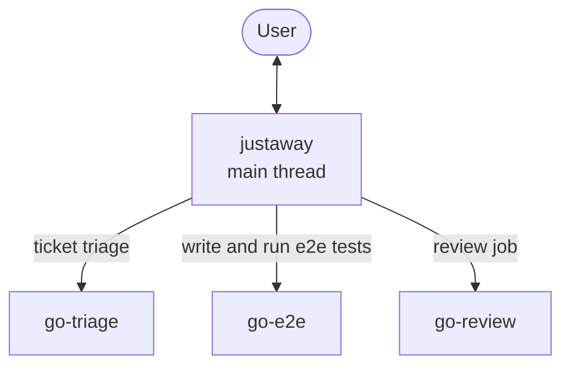
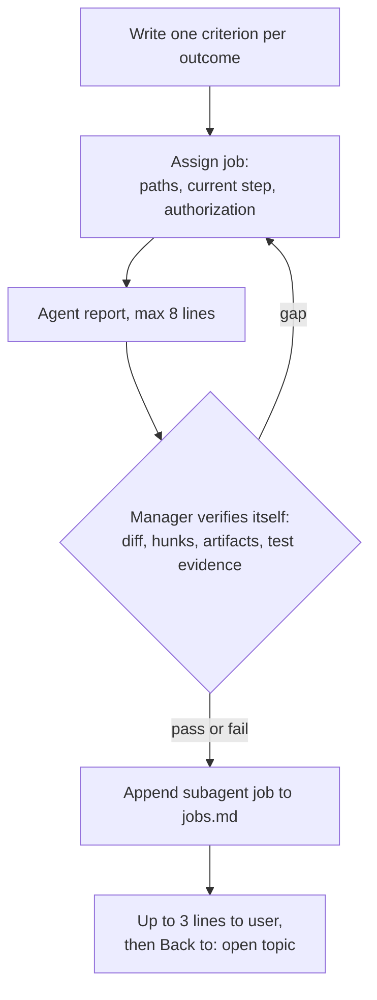

# Architecture

## Agents and skills

- `justaway` runs in the main thread.
- It runs `go-plan` (needs the user), `go-work` and `go-fix` itself.
- Other jobs go to a subagent running one skill, with the model and effort `agents.md` sets.
- Skills return results in the reply. Only the manager saves docs.
- `to-*` skills are user-invoked. The manager never runs them.

## Ticket flow

## Manager loop

## Why this structure

### Handoffs

- Subagents are general-purpose agents, never forks. They get only the text or paths the job needs.
- The manager writes and runs unit specs per step through `go-work`. `go-e2e` writes and runs e2e specs once, before review.
- Agents report in at most eight lines. The manager announces a job in one line and reports in at most three.
- Subagent job detail: `state/jobs.md`. The manager's own jobs: `checklist.md`.

### Manager

- A plan step runs in the main thread: no development agent per step. `checklist.md` carries progress.
  - Trade-off: the main thread's context grows and runs on the session's model.
- Other agents stay alive per ticket. Later work goes by SendMessage to the recorded ID in `jobs.md`. A gone agent is replaced by a fresh one reading the plan, `checklist.md` and `jobs.md`.
- An agent's "done" is a claim: the manager checks diff, artifacts, tests.
- The manager sets `model` and `effort` per skill and announces them. The user can override. See [agents.md](../../skills/justaway/references/agents.md).

### Plan and tests

- Plan approval is the gate. Per-step commits: approval covers every step, its one-line commit message and the `Deletions`.
- `go-plan` confirms a checkable `Goal` with the user. Only a user requirement change alters it.
- `go-work` works until the goal holds. It asks only when:
  1. Three different fixes failed.
  2. A step needs an unlisted deletion or an out-of-plan change.
  3. The plan is unclear.
- The author runs the test: the manager runs unit specs in the loop and, for a review, writes the result into `review.md`. Only changed specs run; other possibly affected ones are reported.

### Review and storage

- One `go-review` subagent re-reviews the ticket, given the previous `review.md`. The manager saves its full report over it. Only `go-review` reviews.
  - Trade-off: it carries its earlier findings, so it is less independent than a fresh read.
- Plugin files live outside the repo: `~/.just-do-it/{project}/` holds `docs/` (glossary, ADRs) and one folder per branch (plan, checklist, review, PR text, commit format, `state/`, `attachments/`).

### Skills

- A skill reads only its own `references/`; others are called by name.
- Claude Code first: subagents work only there. Skills are plain `SKILL.md` files, so other hosts run them directly, without subagents.
