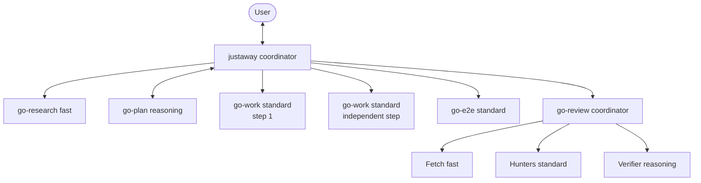

# Architecture

## Coordination

`justaway` runs in the main thread. It owns user communication, scope, approval, scheduling, verification, commits, and output delivery. Workers receive the specific inputs and authority they need. Each worker reads its own repository evidence.

## Plan and build

- `go-research` reads live requirements and returns source and test pointers. Routine Git reads, repository search, and folder discovery stay with the thread that needs them.
- `go-plan` owns the grill and draft across rounds. The coordinator delivers questions and user answers, then delivers the plan and checklist for approval.
- Each approved step gets one `go-work` worker in the current checkout and branch. Ready steps run together when their writes and test execution are independent. Run whole TDD steps in sequence when test independence is unclear. Each worker runs `dev-tdd` at its approved seams and returns red and green evidence.
- The coordinator verifies the diff and evidence, serializes approved per-step commits, and records progress. Dependent steps start after their prerequisites are delivered.
- `go-e2e` owns the scoped E2E job and reruns.

## Review

`go-review` owns its team in either mode. The fast Fetch worker supplies review inputs. Hunters and verifier follow the Quick, Standard, or Deep tier. Re-review checks open findings and the delta within its round cap. `to-test-html` also owns its translation worker in either mode.

## Delivery

[Output delivery](../../skills/justaway/references/storage.md#output-delivery) controls final research, plan, review, PR, and QA guide results. Managed workers return their results privately. The user-facing thread saves to an identified task directory or prints the result when requested. Saved outputs are reported by path. The conventional directory is `~/.just-do-it/{project}/{branch}/`.

[Host mapping](../../skills/justaway/references/agents.md#host-mapping) · [Scheduling](../../skills/justaway/references/reuse.md#parallel-steps) · [Review agents](../../skills/go-review/references/agents.md)
