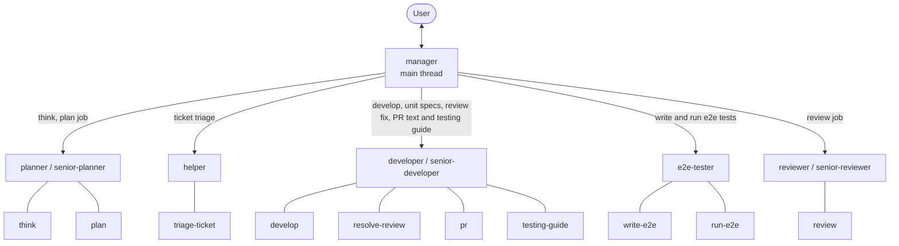
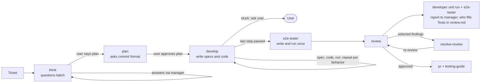
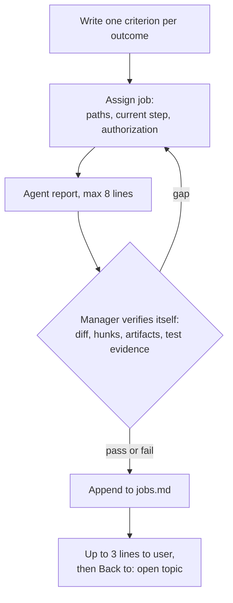

# Architecture

## Agents and skills

`manager` runs in the main thread. It assigns each job to one of eight agents: five roles, each with a default agent and, for three roles, variants the manager uses only with the user's approval. Each agent holds several skills and does its job itself. Only agents carry role names; skills are named by action.

## Ticket flow

## Manager loop

## Planner questions

`planner` cannot talk to the user directly. It returns one numbered batch of at most seven questions from `think`, each with a recommended answer, or the commit-format question from `plan`. The manager shows the batch unchanged and sends the answers back to the same planner. Each round costs a little manager context; the planner's own context stays cached. Fewer rounds cost fewer tokens, so answer by number.

## Why this structure

- **Small handoffs.** Agents start by plugin type, never as a fork of the main thread, and receive paths only. `state/context.md` holds the rule files and comparable specs the first developer found, so later agents skip the search.
- **Fewer agents, fewer re-reads.** Each new agent re-reads rules, plan, and diff. Earlier, one plan step started about four agents: developer, spec writer, and two runners. Now one `developer` writes the unit specs and code for a step and runs the specs itself, and `e2e-tester` writes and runs the e2e specs once, before review.
- **One developer per variant per ticket.** A plan step goes to the ticket's existing `developer` or `senior-developer`, by the step's difficulty, so a 12-step ticket starts at most two developers, not twelve. `checklist.md` carries progress between steps. Trade-off: a developer's context grows over the ticket. Within a ticket, agents stay alive and get later work by SendMessage to the same ID, so a re-test or re-review does not re-read the rules, plan, and diff. Finished agents cost nothing while idle. The manager records each ID in `jobs.md`; if an agent is gone, it starts a fresh one that reads the plan, `checklist.md`, and `jobs.md`.
- **Plan approval is the gate.** With per-step commits, approving the plan approves every step, its one-line commit message, and the file deletions in `Deletions`. The planner confirms a checkable `Goal` with the user, and only the user's requirement change alters it. `develop` keeps working until the goal holds. It stops and asks only after three different fixes fail, when a step needs an unlisted deletion or a change outside the plan, or when the plan is unclear.
- **The test author runs the test.** `developer` writes unit specs test-first, one behavior at a time, and runs them in the same loop; for a review it runs them and reports to the manager, who writes the result into `review.md`. `e2e-tester` writes and runs the e2e specs, so QA owns QA tests. A job of more than 10 specs is split across extra developers, 10 specs each. Runs cover only the specs the task changed; other specs that may be affected are reported, not run.
- **Plugin files live outside the repo.** Each project gets one folder, `~/.agent-workflow/{project}/`, holding its glossary and ADRs in `docs/` and one folder per branch with its plan, checklist, review, PR text, commit format, `state/` and `attachments/`.
- **Reviewer reuse.** The same reviewer re-reviews the ticket and updates `review.md` in place. Trade-off: a re-review carries its earlier findings, so it is less independent than a fresh read.
- **Manager verifies, not trusts.** An agent's "done" is a claim. The manager checks the diff, artifacts, and test result itself before reporting.
- **Short reports.** Agents report in at most eight lines; the manager announces a job in one line and reports it in at most three. Detail lives in `state/jobs.md` in the branch folder.
- **Model by agent.** Each agent sets its own `model` and `effort` in its frontmatter, and the manager assigns each role's default agent, asking the user before it uses a variant: `planner` or `senior-planner`, `helper`, `developer` or `senior-developer`, and `reviewer` or `senior-reviewer`. See [agents.md](../../skills/manager/references/agents.md).
- **Claude Code first.** Agents work only in Claude Code. Skills stay plain `SKILL.md` files, so other hosts run them directly on the chat's own model, with no subagents.
