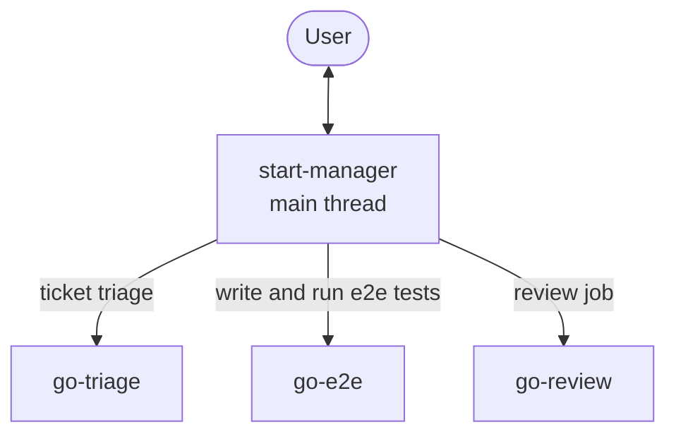
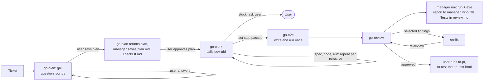
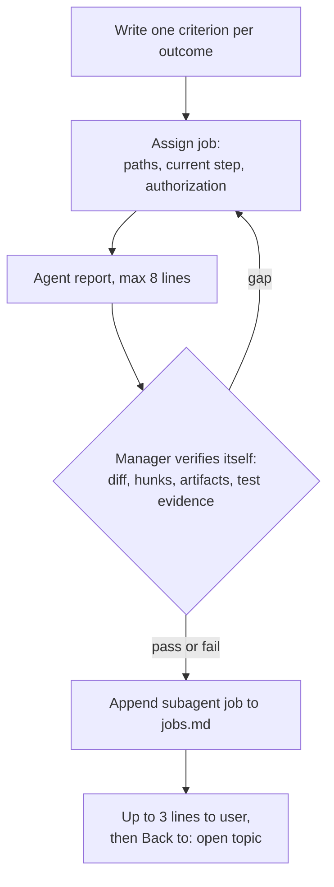

# Architecture

## Agents and skills

`start-manager` runs in the main thread. It runs `go-plan` itself, since planning needs the user, and runs `go-work` and `go-fix` itself, and assigns the other jobs to a subagent that runs one skill, with the model and effort `agents.md` sets for that skill. No skill writes plugin docs: each returns its result in the reply and the manager saves it. `to-*` skills are user-invoked and never run by the manager.

## Ticket flow

## Manager loop

## Why this structure

### Handoffs

- **Small handoffs.**
  - Subagents start as general-purpose agents, never as a fork of the main thread.
  - They receive the text or paths the job needs.
  - `state/context.md` holds the rule files and comparable specs the manager found, so later agents skip the search.
- **Fewer agents, fewer re-reads.**
  - Each new agent re-reads rules, plan, and diff.
  - The manager writes unit specs and code per step through `go-work` and runs the specs itself.
  - `go-e2e` writes and runs the e2e specs once, before review.
- **Short reports.**
  - Agents report in at most eight lines.
  - The manager announces a job in one line and reports it in at most three.
  - Subagent job detail lives in `state/jobs.md`; the manager's own jobs are tracked in `checklist.md` only.

### Manager

- **The manager develops.**
  - A plan step runs in the main thread: a 12-step ticket starts no development agent.
  - `checklist.md` carries progress between steps.
  - Trade-off: the main thread's context grows over the ticket, and it runs on the session's model instead of sonnet medium.
  - Other agents stay alive within a ticket and get later work by SendMessage to the same ID: a re-test or re-review does not re-read rules, plan, and diff.
  - The manager records each ID in `jobs.md`. A gone agent is replaced by a fresh one that reads the plan, `checklist.md`, and `jobs.md`.
- **The manager verifies, not trusts.** An agent's "done" is a claim. The manager checks the diff, artifacts, and test result before reporting.
- **The manager owns docs.** Skills return results in the reply; only the manager saves them.
- **Model by skill.** The manager sets `model` and `effort` per skill on each start and announces them. The user can override. See [agents.md](../../skills/start-manager/references/agents.md).

### Plan and tests

- **Plan approval is the gate.**
  - With per-step commits, approving the plan approves every step, its one-line commit message, and the file deletions in `Deletions`.
  - `go-plan` confirms a checkable `Goal` with the user. Only a user requirement change alters it.
  - `go-work` keeps working until the goal holds. It stops and asks only when:
    1. Three different fixes failed.
    2. A step needs an unlisted deletion or a change outside the plan.
    3. The plan is unclear.
- **The test author runs the test.**
  - The manager writes unit specs test-first, one behavior at a time, and runs them in the same loop.
  - For a review it runs them and writes the result into `review.md`.
  - `go-e2e` writes and runs the e2e specs.
  - Runs cover only the specs the task changed. Other specs that may be affected are reported, not run.

### Review and storage

- **Review reuse.**
  - The same `go-review` subagent re-reviews the ticket, given the previous `review.md`. The manager saves its full report over it.
  - Only `go-review` reviews.
  - Trade-off: a re-review carries its earlier findings, so it is less independent than a fresh read.
- **Plugin files live outside the repo.**
  - One folder per project: `~/.just-do-it/{project}/`.
  - `docs/` holds the glossary and ADRs.
  - One folder per branch holds the plan, checklist, review, PR text, commit format, `state/` and `attachments/`.

### Skills

- **Skills do not read each other.** A skill reads only its own `references/` and calls other skills by name, so each stays a self-contained job.
- **Claude Code first.** Subagents work only in Claude Code. Skills stay plain `SKILL.md` files, so other hosts run them directly on the chat's own model, with no subagents.
