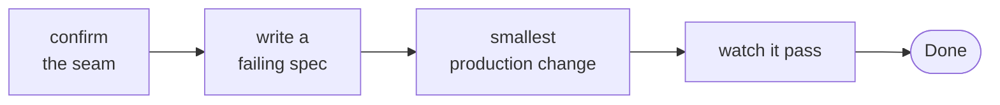
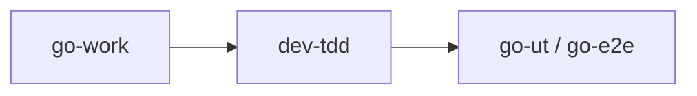

# dev-tdd

Drives one step or behavior test-first.

## DO IT

| Does | Detail |
| --- | --- |
| Per behavior | Confirm the seam, write a failing spec, make the smallest production change, watch it pass |
| Calls | `go-ut` for unit specs; `go-e2e` for e2e specs, only when the user or plan asks for e2e |
| Reports | `Done` (at most 20 words) naming the spec that failed before and the run that passed after |

| Gives | Never |
| --- | --- |
| `Done` report | Edits a spec to match wrong code. Changes an existing assertion only when the expected behavior changed, and says why in `Open` |
| | Writes plan docs. Skips the loop for untestable changes, such as pure styling, and says so |

## USE IT

| Situation | Use |
| --- | --- |
| "Do this test-first", "red-green this fix" | `dev-tdd` |
| Build a whole plan | `go-work` (calls it) |
| One spec, no loop | `go-ut` |

The manager does not call it directly.

## WORK IT

| Sign | Means |
| --- | --- |
| A seam is confirmed before the first spec | Spec aims at the right place |
| The red run happens once, before any production change | Failure was seen |
| `Open` says `red not observed` | Red could not be seen |
| Production code changes only enough to pass the spec | No extra code |
| Each step ends with its specs passing | Step is done |

## FIT IT

| Caller | What happens |
| --- | --- |
| `go-work` | Calls it once per step |
| `go-ut`, `go-e2e` | Do the spec work and runs |
