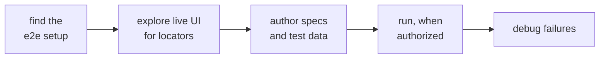
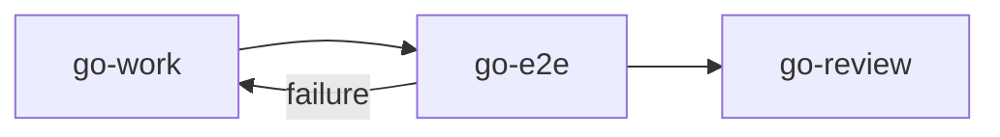

# go-e2e

Authors, explores, runs and debugs Playwright e2e tests. The manager runs it in a subagent; you can call it directly.

## DO IT

| Does | Detail |
| --- | --- |
| Authors, explores, runs, debugs | Specs and test data, locators found by exploring the live UI, runs specs, debugs failures, using `playwright-cli` |
| Writes | Only specs and test data in the repo |
| Runs | Writing a spec never runs it. It runs only when authorized, and never resets environments or test data unless asked |

| Hands off | To |
| --- | --- |
| Production changes, such as a missing test selector | `go-work` |
| Formal review | `go-review` |

## USE IT

| Situation | Use |
| --- | --- |
| Add, find a locator, run or fix an e2e test | `go-e2e` |
| Add a missing selector in production code | `go-work` |

The manager calls it once, after the last step, for the specs the plan's `E2E` line names.

## WORK IT

| Sign | Means |
| --- | --- |
| It finds the e2e setup first, and writes nothing when there is none | Setup respected |
| Specs come from explored locators, not from reading source alone | Locators are real |
| A run names exact spec files, never a folder or the full suite, and reports the real exit code | Run is exact |
| A failure comes with a log path and the symptom, not a guessed cause | Failure is evidenced |

## FIT IT

| Caller | What happens |
| --- | --- |
| Before it | The manager's final validation, when the plan's `E2E` line is not `none` |
| `dev-tdd` | Calls it when e2e specs are asked for |
| After it | `go-review`; a failure goes back to `go-work` |
