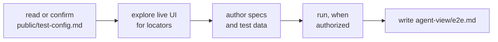

# go-e2e

Authors, explores, runs and debugs Playwright E2E tests, and writes the test run report to `agent-view/e2e.md`. Called by `go-flow`, `dev-tdd`, or by you directly.

## DO IT

| Does | Detail |
| --- | --- |
| Setup | Reads `~/.just-do-it/{project}/public/test-config.md`. If missing, triggers `go-setup` test-config confirmation with the user |
| Authors, explores, runs, debugs | Specs and test data, locators found by exploring the live UI, runs specs, debugs failures, using `playwright-cli` |
| Writes in repo | Only specs and test data in the repo |
| Writes to storage | `~/.just-do-it/{project}/{branch}/agent-view/e2e.md` |

[Skill](../skills/go-e2e/SKILL.md) · [Storage](../skills/go-setup/references/storage.md)
