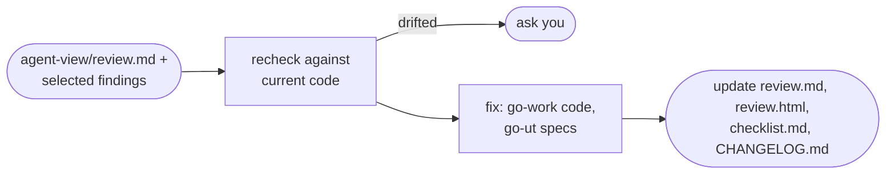

# go-fix

Fix selected findings from `agent-view/review.md`, record dispositions in `agent-view/review.md`, `dev-view/review.html`, and `agent-view/checklist.md`, and update `agent-view/CHANGELOG.md` on commit.

## DO IT

| Step | Does |
| --- | --- |
| Reads | `agent-view/review.md`, `agent-view/plan.md`, `agent-view/checklist.md`, `public/glossary.md`, `public/adr/` |
| Rechecks | Each selected finding against current code, and asks when code has drifted |
| Fixes | Production code through `go-work`, unit specs through `go-ut` (updating `agent-view/ut.md`) |
| Updates storage | Moves resolved findings to `RESOLVED` in `agent-view/review.md` and `dev-view/review.html`, records progress in `agent-view/checklist.md`, and logs commits in `agent-view/CHANGELOG.md` |

[Skill](../skills/go-fix/SKILL.md) · [Storage](../skills/go-setup/references/storage.md)
