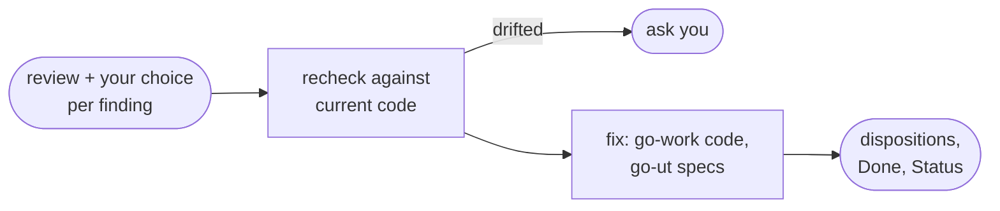

# go-fix

Fix the review findings you select and return a numbered disposition for each. The manager runs it in the main thread; you can also call it directly.

## DO IT

| Step | Does |
| --- | --- |
| Takes | A review (text or path) and your choice per finding: accepted, deferred, disputed or ignored |
| Rechecks | Each selected finding against the current code, and asks when the code has drifted |
| Fixes | Production code through `go-work`, unit specs through `go-ut` |
| Hands back | e2e findings as `Open` for `go-e2e` |

| Gives | Never |
| --- | --- |
| Per finding: a disposition, a `Done` line of at most 20 words and a `Status`, plus the open count by severity | Writes `review.md` or a checklist; commits, unless you approve an exact commit message |
| `Status: approved` when told "Set status to approved" | Changes anything on "Set status to approved" |

## USE IT

| Situation | Use |
| --- | --- |
| "Fix review findings 1 and 3" | `go-fix` |
| You want the fixes checked again | `go-review` |
| No review exists yet | `go-review` first |
| The manager has selected findings | It runs `go-fix` itself, before anything else, and records the dispositions |

## WORK IT

| Sign | Means |
| --- | --- |
| Finding IDs are kept exactly as in the review | Traceable |
| Every selected finding has an evidenced outcome | Nothing skipped |
| Findings you didn't select are untouched | Scope held |
| Deferred and disputed findings stay open | Not hidden |
| It reports validation limits, such as tests it was not allowed to run | Honest gaps |

## FIT IT

| Link | What happens |
| --- | --- |
| Input | It fixes only what `go-review` found and you chose |
| Calls | `go-work` and `go-ut` for the code and specs, `go-e2e` for e2e findings |
| `justaway` | Records the dispositions in `review.md` and `checklist.md` |
