# go-flow

Drop a ticket to start. You can specify Brainstorm or Lite, short or full planning, a stop point, or a stage to resume.

```mermaid
flowchart LR
    Start([Start]) -->|resolve ticket and storage| S[to-spec]
    S -->|choose Lite and clarify scope| P[to-plan]
    S -->|choose Brainstorm| H[Confirm working hypothesis]
    H -->|dispatch seven Goldfish and settle scope| P
    P -->|review full, risky or requested plan| R[go-review plan]
    P -->|request approval for short plan| A[Approve exact scope]
    R -->|present findings for decision| A
    A -->|run approved pipelines| W[go-work]
    W -->|integrate and verify| T[go-ut / go-e2e]
    T -->|review current evidence| C[go-review code]
    C -->|fix authorized findings| F[go-fix]
    F -->|verify affected behavior| T
    C -->|complete scope and evidence| End([End])
```

| Stage | Execution | Result |
| --- | --- | --- |
| Spec | Current conversation. Brainstorm dispatches seven Standard workers after hypothesis confirmation. Lite stays inline. | `spec.md`, `spec.html`; when grilled, scope changes or requested spec stop applies, wait for spec confirmation. |
| Plan | Current conversation. Use a short or full plan and assign steps and dependencies to pipelines. | `plan.md`, `checklist.md`, `plan.html` |
| Plan review | One fresh Deep reviewer; another only for specific risk. | `plan-review.md`, `plan-review.html`. User disposition and final approval. |
| Build | One pipeline inline. With multiple, one Standard worker per ready pipeline, even if it is the only one ready. | Scoped source/spec changes and checklist evidence. |
| Verify | Run scoped verification; delegate only independent suites with isolated resources. | `ut.md`, `e2e.md` |
| Code review/fix | Standard or Deep coverage. Fix only authorized findings. | `review.md`, `review.html` |

For example, ask “stop after plan review” or “resume from the approved plan and stop after tests.” A changed scope needs fresh approval; progress and test evidence can change during work.

[Skill](../skills/go-flow/SKILL.md) · [Agent mapping](../skills/go-flow/references/agents.md#host-mapping) · [Scheduling](../skills/go-flow/references/scheduling.md#approved-pipelines) · [Storage](../skills/go-setup/references/storage.md)
