# go-flow

Stateless pipeline skill that chains ticket skills over `~/.just-do-it/{project}/{branch}/`. Run the full ticket workflow or request any slice of steps (such as `spec -> plan` or `plan -> work -> review`).

Skills can also run independently. If branch storage is missing, they trigger `go-setup` to confirm the project and create it. Branch-specific files live in `agent-view/` and `dev-view/`; `public/` is shared across the project. See [Storage](../skills/go-setup/references/storage.md) for the complete layout.

```mermaid
flowchart LR
    Start([Start]) -->|start workflow| S[go-setup]
    S -->|confirm project and get spec| R[to-spec]
    R -->|spec ready| P[go-plan]
    R -->|spec blocked| Stop
    P -->|approve plan and build| A[go-work<br/>one worktree per ready step]
    A -->|integrate commit groups| T[go-ut + go-e2e<br/>ut.md & e2e.md]
    T -->|fix failed tests| W[go-work<br/>fix and retry within limit]
    W -->|check test result| Q{Tests pass?}
    Q -->|continue when passing| V
    Q -->|stop when limit reached| Stop([Stop and ask user])
    T -->|review passing tests| V[go-review]
    V -->|fix in-scope findings| F[go-fix and affected tests]
    F -->|findings settled| C[Final tests on current snapshot]
    C -->|current tests pass| V
    V -->|current full review clean| End([End])
```

| Stage | Who runs it | Writes to storage |
| --- | --- | --- |
| 1. Setup | `go-setup` (main thread) | Confirms `{project}`; creates `agent-view/`, `dev-view/`, `public/` |
| 2. Spec | `to-spec` (`fast`) | `agent-view/spec.md`, `agent-view/attachments/{ticket}/`, `dev-view/spec.html`. Stops and asks if a required source is unavailable |
| 3. Grill & plan | `go-plan` (`reasoning`) | `agent-view/plan.md`, `agent-view/checklist.md`, `agent-view/commit-format.md`, `agent-view/diagnose.md`, `dev-view/plan.html`, plus on-demand `public/glossary.md` & `public/adr/` |
| 4. Build | `go-work` (`standard`, one worker per step, parallel when independent; drives `dev-tdd`) | Code & specs, `agent-view/checklist.md`, `agent-view/CHANGELOG.md` |
| 5. Test | `go-ut` + `go-e2e` (`standard`) | Runs touched unit specs and planned E2E specs, writing `agent-view/ut.md` and `agent-view/e2e.md`. Failed tests are fixed and retried up to the project limit; if exhausted, stop and ask the user |
| 6. Review | `go-review` (main thread + review team) | Reads `agent-view/ut.md` & `agent-view/e2e.md`; writes `agent-view/review.md` and `dev-view/review.html` |
| 7. Fix loop | `go-fix` → affected tests → full delivery review | Checks selected fixes only during the fix loop. Refreshes stale required test evidence and requires a clean full review of the delivery snapshot. Reuses a matching full review |

[Skill](../skills/go-flow/SKILL.md) · [Agent mapping](../skills/go-flow/references/agents.md#host-mapping) · [Scheduling](../skills/go-flow/references/scheduling.md#parallel-steps) · [Storage](../skills/go-setup/references/storage.md)
