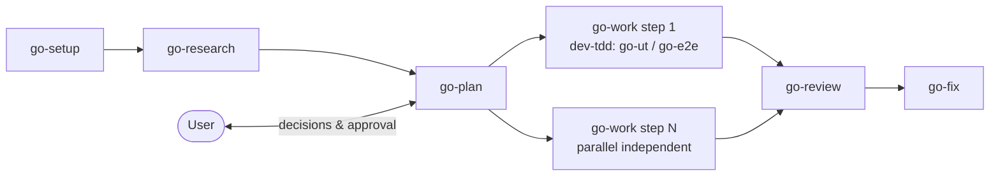

# go-flow

Stateless pipeline skill that chains the independent `go-*` skills over `~/.just-do-it/{project}/{branch}/`. Run the full ticket workflow or request any slice of steps (such as `research -> plan` or `plan -> work -> review`).

| Stage | Who runs it | Writes to storage |
| --- | --- | --- |
| 1. Setup | `go-setup` (main thread) | Confirms `{project}`; creates `agent-view/`, `dev-view/`, `public/` |
| 2. Research | `go-research` (`fast`) | `agent-view/research.md`, `agent-view/attachments/{ticket}/` |
| 3. Grill & plan | `go-plan` (`reasoning`) | `agent-view/plan.md`, `agent-view/checklist.md`, `agent-view/commit-format.md`, `agent-view/diagnose.md`, plus on-demand `public/glossary.md` & `public/adr/` |
| 4. Build & test | `go-work` (`standard`, one worker per step, parallel when independent; drives `dev-tdd` → `go-ut` / `go-e2e`) | `agent-view/checklist.md`, `agent-view/CHANGELOG.md`, `dev-view/ut.md`, `dev-view/e2e.md` |
| 5. Review | `go-review` (main thread + review team) | `dev-view/review.md` (references `dev-view/ut.md` & `dev-view/e2e.md`) |
| 6. Fix | `go-fix` (main thread) | Updates `dev-view/review.md`, `agent-view/checklist.md`, `agent-view/CHANGELOG.md` |

[Skill](../skills/go-flow/SKILL.md) · [Agent mapping](../skills/go-flow/references/agents.md#host-mapping) · [Scheduling](../skills/go-flow/references/reuse.md#parallel-steps) · [Storage](../skills/go-setup/references/storage.md)
