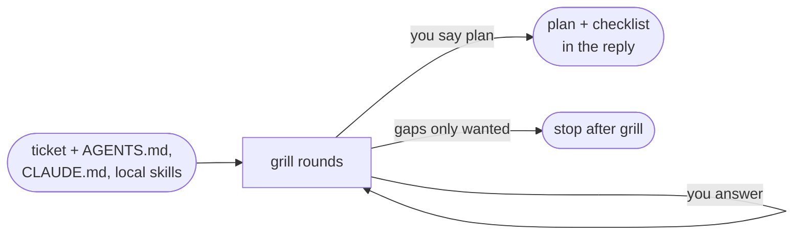
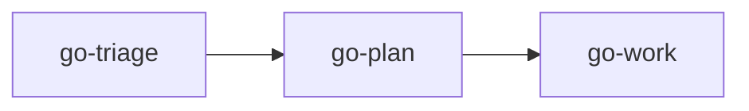

# go-plan

Think through one ticket with you, then return a plan and checklist for approval. The manager runs it in the main thread; you can also call it directly.

## DO IT

| Step | Does |
| --- | --- |
| Takes | A ticket (link or pasted requirements), plus `AGENTS.md`, `CLAUDE.md` and project-local skills |
| Grills | In rounds: each round asks every open decision whose prerequisites are settled, numbered, each with a recommended answer on its own line below the question |
| Returns | The plan (Goal, acceptance criteria, testing, decisions, steps, deletions) and the checklist in the reply |
| Stops | After the grill when you only want gaps found |

| Gives | Never |
| --- | --- |
| Plan and checklist in the reply | Writes code, tests or files. The caller saves the plan |

## USE IT

| Situation | Use |
| --- | --- |
| "Plan PROJ-123", "what is unclear here", "break this into steps" | `go-plan` |
| You only want requirements read from a ticket | `go-triage` |
| The plan is approved and you want it built | `go-work` |
| The manager has a ticket | It runs `go-triage` first, then `go-plan` itself, because only the main thread can ask you questions |

## WORK IT

| Sign | Means |
| --- | --- |
| Questions come in numbered rounds, each with a recommended answer, and none the code already answers | Grill is efficient |
| A ticket link triggers `go-triage` first | Requirements are read |
| The session ends only when you say the picture is shared and then say plan | You are in control |
| Every acceptance criterion maps to a step with a named failing test | Plan is testable |
| Every step has a one-line commit message | Plan is committable |

## FIT IT

| Link | What happens |
| --- | --- |
| `go-triage` | Supplies the requirements brief before the grill |
| `go-work` | Builds from the approved plan |
| `justaway` | Saves the returned plan and checklist as `plan.md` and `checklist.md` |
