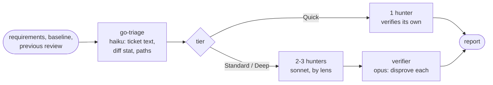
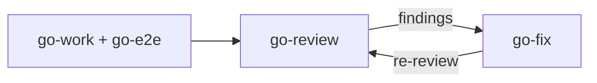

# go-review

Review a branch, diff or work-in-progress change and return the review report. It runs in the main thread, called by the manager or directly, and starts its own review agents. It is the only skill that reviews.

## DO IT

| Tier | When | Agents |
| --- | --- | --- |
| Quick | ≤150 lines, ≤3 files, no risky path | 1 sonnet hunter, verifies its own |
| Standard | everything else | Correctness + Contract hunters (sonnet), 1 verifier (opus) |
| Deep | auth, billing, schema, secrets, CI, release, installers, `REVIEW.md` paths, or >1000 lines | + Security hunter |

| Re-review step | Does |
| --- | --- |
| Open finding, file untouched | Stays in `TODO`, no agent |
| Open finding, file touched | Haiku recheck: `fixed`, or `open` when unsure |
| New changes | Hunted alone; earlier findings passed as known |
| Round 4+ | No new hunting; asks you to reconsider the approach |

| Gives | Never |
| --- | --- |
| Full report in the reply: `TODO`, `RESOLVED`, `IGNORED`, `PRE-EXISTING` (uncounted), reference with `Tier`, `Round` | Runs tests, edits source, writes files. `Tests` stays "not run" for the manager |

## USE IT

| Situation | Use |
| --- | --- |
| "Review my branch", "review this diff" | `go-review` |
| Findings are chosen for fixing | `go-fix` |
| The manager has finished a step or the e2e run passed | It sends the baseline and scope to `go-review` |

## WORK IT

| Sign | Means |
| --- | --- |
| Baseline stated, diff not empty | Right range reviewed |
| Every hunk read before "no actionable findings" | Nothing skipped |
| Each finding cites lines and what breaks | Verified, not a guess |
| Fixed items in `RESOLVED`, new ones numbered after the last | Re-review worked |

## FIT IT

| Caller | What happens |
| --- | --- |
| You, directly | Report only; ask for `go-fix` when you want fixes |
| `justaway` | Sends every finding to `go-fix`, re-reviews once, saves `review.md`, fills `Tests` |
