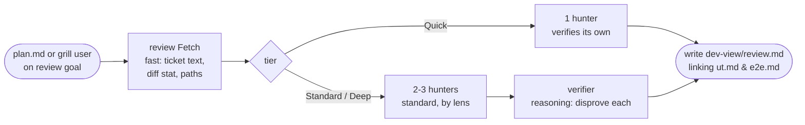

# go-review

Review a branch, diff or work-in-progress change and write `dev-view/review.md`. Runs in the main thread, called by `go-flow` or directly, and starts its own review agents.

Subagents are required; an unavailable agent blocks the review.

## DO IT

| Feature | Detail |
| --- | --- |
| Goal & review plan | Reads `agent-view/plan.md` when present. When called directly without `plan.md` (or when goal is unclear), grills the user on the target goal and confirms a review plan before launching hunters |
| Tests section | Links `[ut.md](ut.md)` and `[e2e.md](e2e.md)` in `dev-view/` when present (left empty when absent) |
| Output | Always writes `~/.just-do-it/{project}/{branch}/dev-view/review.md` |

| Tier | When | Agents |
| --- | --- | --- |
| Quick | ≤150 lines, ≤3 files, no risky path | 1 `standard` hunter, verifies its own |
| Standard | everything else | Correctness + Contract hunters (`standard`), 1 verifier (`reasoning`) |
| Deep | auth, billing, schema, secrets, CI, release, installers, `REVIEW.md` paths, or >1000 lines | + Security hunter |

[Skill](../skills/go-review/SKILL.md) · [Report format](../skills/go-review/references/report-format.md) · [Storage](../skills/go-setup/references/storage.md)
