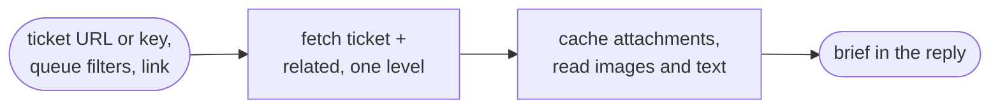
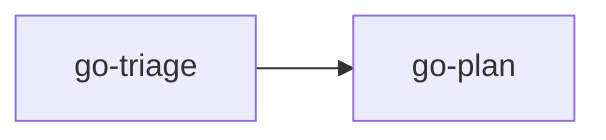

# go-triage

Read a ticket, a queue or a pasted link and return a short requirements brief. The manager runs it as a subagent; you can also call it directly.

## DO IT

| Step | Does |
| --- | --- |
| Takes | A ticket URL or key, queue filters, or any pasted link |
| Fetches | Summary, description, status and comments from the tracker, and the same text for each related ticket one level deep: issue links, parent, subtasks, keys named in the text. Linked pages are read in full |
| Attachments | Cached; every image and text file is read. Videos are listed by name and you are asked to describe them |
| Returns | A brief in the reply: requirements, acceptance criteria, open questions, code pointers and a source reference |
| With a checkout | Maps likely affected components with file evidence, labeled as an estimate |

| Job | Does |
| --- | --- |
| Triage | Returns the requirements brief |
| Fetch | Called as a haiku low subagent by other skills (`go-review`, and any skill that needs it) to do search and fetching: ticket text; git facts (baseline evidence, `git diff --stat`, changed paths, files a delta touches); code search (where a symbol is used); file text (such as `REVIEW.md`). Returns raw facts only, no judgement, writes nothing |

| Gives | Never |
| --- | --- |
| Brief in the reply | Changes a ticket field, posts a comment, approves anything, writes files (read-only) |

## USE IT

| Situation | Use |
| --- | --- |
| "Triage PROJ-123", "what does this ticket need", "go through my queue", a pasted URL | `go-triage` |
| You want the ticket turned into a plan | `go-plan` |
| The manager gets a pasted link | It runs `go-triage` first, so the research exists before any planning |
| `go-review`, or any skill that needs ticket text, git facts or code search | Calls the `go-triage` Fetch job as a haiku low subagent |

## WORK IT

| Sign | Means |
| --- | --- |
| Each fetched ticket lists requirements, acceptance criteria and open questions, each with a source | Brief is sourced |
| Every attachment is either read or listed | Nothing skipped |
| Requirements stay apart from comments, proposals and conflicts | Clean brief |
| A later link returns the whole updated brief, not a fragment | Brief is current |
| No credentials or personal data appear in the brief | Safe to share |

## FIT IT

| Link | What happens |
| --- | --- |
| `go-plan` | Takes the brief as context, not as approved scope |
| `justaway` | Saves the returned brief as `triage.md` |
