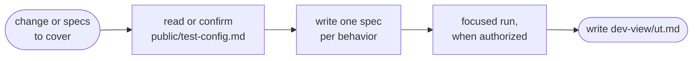

# go-ut

Writes, fixes or runs unit specs for changed code, and writes the test run report to `dev-view/ut.md`. Called by `dev-tdd` and `go-work`, or by you directly.

## DO IT

| Does | Detail |
| --- | --- |
| Setup | Reads `~/.just-do-it/{project}/public/test-config.md`. If missing, triggers `go-setup` test-config confirmation with the user |
| Writes in repo | One spec per behavior beside the code, with a coverage comment |
| Runs | Only focused specs, and only when authorized |
| Writes to storage | `~/.just-do-it/{project}/{branch}/dev-view/ut.md` |

[Skill](../skills/go-ut/SKILL.md) · [Storage](../skills/go-setup/references/storage.md)
