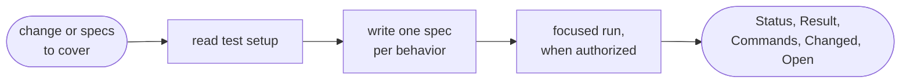
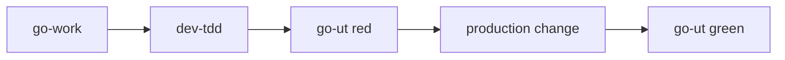

# go-ut

Writes, fixes or runs unit specs for changed code. Called by `dev-tdd` and `go-work`, or by you directly.

## DO IT

| Does | Detail |
| --- | --- |
| Input | The change or specs to cover, as text or a path you name |
| Writes | One spec per behavior beside the code, with a coverage comment, following the project's test setup and mocking rules |
| Runs | Only focused specs, and only when authorized |
| Reports | `Status` / `Result` / `Commands` / `Changed` / `Open` |

| Gives | Never |
| --- | --- |
| Specs and the report | Changes production code (it reports defects for `go-work`) |
| | Runs the full suite unless asked |
| | Touches e2e specs |

## USE IT

| Situation | Use |
| --- | --- |
| Add or fix unit specs, run a spec | `go-ut` |
| Build a feature test-first | `go-work` (calls `dev-tdd`) |
| e2e specs | `go-e2e` |

The manager calls it for unit runs before review.

## WORK IT

| Sign | Means |
| --- | --- |
| It reads the project's test setup first, and says `no unit test setup` when there is none | Setup respected |
| Each spec covers one behavior and carries a `Covered` comment | Specs are traceable |
| A run uses one exact command, on the named spec only, with a real exit code | Run is exact |
| A production bug is reported, not fixed | Scope held |

## FIT IT

| Link | What happens |
| --- | --- |
| `dev-tdd` | Calls it for the red and green runs |
| Failing run | Goes back to `go-work`; e2e goes to `go-e2e` |
