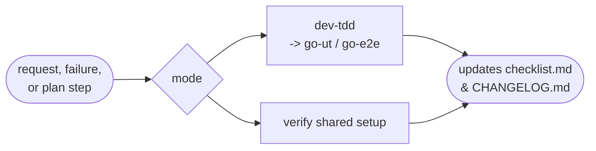

# go-work

Implements one feature or function, test-first, with commits grouped by purpose. A single approved pipeline runs inline. Multiple approved pipelines each keep one worker and worktree; its dependent steps run in order. The coordinator integrates the resulting commits. You can also call `go-work` directly.

## DO IT

| Mode | Does |
| --- | --- |
| Direct request | Implements an annotated UI or other direct request inline, updates `agent-view/CHANGELOG.md` on commit |
| Failure to fix | Diagnoses first (`agent-view/diagnose.md`), then fixes |
| Plan step | Owns the test, fix, and local setup for one behavior, updates `agent-view/checklist.md` and `agent-view/CHANGELOG.md` |
| Specs only | Calls `go-ut` |

| Does | Detail |
| --- | --- |
| Reads | Applicable standards, `agent-view/approval.json` for planned work, `agent-view/plan.md`, `agent-view/checklist.md`, `agent-view/spec.md`, `agent-view/attachments/`, `public/glossary.md`, `public/adr/` |
| Calls | `dev-tdd` once per behavior step (`go-ut` writes `agent-view/ut.md`; `go-e2e` writes `agent-view/e2e.md`) |
| Writes | Source and specs in the repo; updates `agent-view/checklist.md`, `agent-view/CHANGELOG.md`, `agent-view/diagnose.md`, and on-demand `public/glossary.md` / `public/adr/` |

An annotation result names the actual element and source, reused suite or fixture, assertions, and run evidence or reason the tests did not run.

[Skill](../skills/go-work/SKILL.md) · [Storage](../skills/go-setup/references/storage.md)
