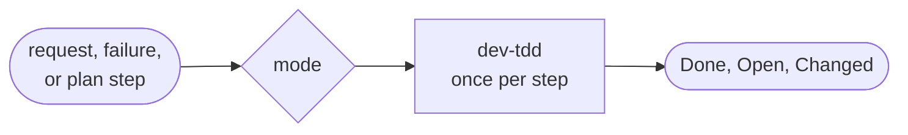
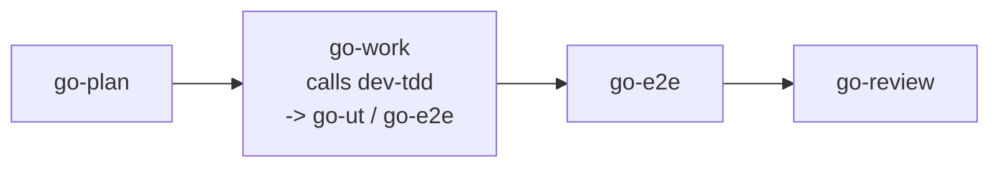

# go-work

Implements one step of work, test-first: a request, one step of a plan, or a failure to fix. The manager runs it in the main thread once per plan step; you can call it directly.

## DO IT

| Mode | Does |
| --- | --- |
| Direct request | Does the request |
| Failure to fix | Diagnose first |
| Plan step | One step only |
| Specs only | Calls `go-ut` |

| Does | Detail |
| --- | --- |
| Input | A request, a failure, or one step of a plan from `go-plan`, as text or a path you name |
| Calls | `dev-tdd` once per step |
| Writes | Source and specs in the repo. Returns `Done` / `Open` / `Changed` |

| Gives | Never |
| --- | --- |
| Source, specs, `Done` / `Open` / `Changed` | Writes `plan.md`, `checklist.md` or `review.md` |
| | Reviews its own work |
| | Creates or pushes branches |
| | Commits, except per the plan or on your approval |

## USE IT

| Situation | Use |
| --- | --- |
| Build a feature, "implement step 2", fix a failure | `go-work` |
| Only unit specs | `go-ut` |
| Review the result | `go-review` |

The manager calls it once per plan step and runs the final validation itself.

## WORK IT

| Sign | Means |
| --- | --- |
| It does exactly one step and stops, ending with a `Done` line | Scope held |
| Specs come before production code, through `dev-tdd` | Test-first |
| It asks only after three different fixes fail, or when a step needs an unlisted deletion or a change outside the plan | Few questions |
| It never starts the next step; it reports `Done`, the commit SHA if any, and `Open` | Clean stop |

## FIT IT

| Position | What happens |
| --- | --- |
| Before it | `go-plan` |
| After the last step | The manager's final validation, then `go-e2e`, then `go-review` |
