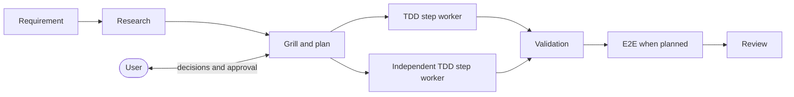

# Justaway

Use `justaway on` to enable manager mode for the session. Use `justaway off` to end it.

| Stage | Who runs it |
| --- | --- |
| Research | `go-research`, fast/low. Reads the ticket or requirements link and maps source and test paths |
| Grill and plan | One `go-plan` worker, reasoning/medium. The coordinator relays questions, answers, and approval |
| Build | One `go-work` worker per step, standard/medium. Independent steps run concurrently. Each worker runs its own TDD loop |
| E2E | One `go-e2e` worker, standard/medium. Runs the exact approved scope |
| Review and fixes | The coordinator runs `go-review` with its existing team and applies findings through `go-fix` |

Workers use the current checkout and branch. The planner looks for steps with separate write paths and independent tests. The coordinator fills available slots with those steps before waiting for results. A conflict delays the affected step while other ready workers continue. The coordinator verifies each step before unlocking its dependents, commits approved work on the current branch, and preserves unrelated changes.

The coordinator saves results to a resolved task directory. If the directory is missing, choose a destination or terminal output. With terminal output, the coordinator keeps task state in the session. Plan approval follows delivery of the plan and checklist.

[Agent mapping](../skills/justaway/references/agents.md#host-mapping) · [Scheduling](../skills/justaway/references/reuse.md#parallel-steps) · [Output delivery](../skills/justaway/references/storage.md#output-delivery)
