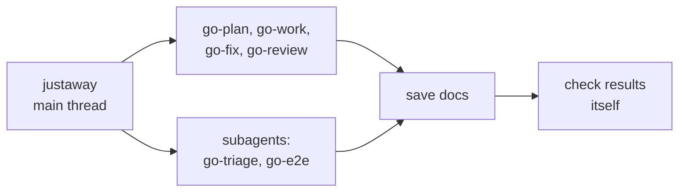
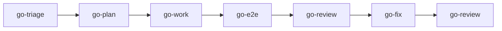

# justaway

Turns the session into a manager that runs the whole ticket flow. You call it with `/justaway on`; the model never starts it.

## DO IT

| Where | Runs |
| --- | --- |
| Main thread | Writes the specs and code itself: runs `go-plan`, `go-work` and `go-fix`, calling `go-work` once per plan step and running the final validation |
| Main thread | Runs `go-review`; it starts its own review agents |
| Subagents | Sends `go-triage` and `go-e2e` to subagents, and announces each model and effort |

| Does | Detail |
| --- | --- |
| Saves | Every plugin doc the skills return: `plan.md`, `checklist.md`, `review.md`, `triage.md`, `state/diagnose.md`, `state/jobs.md` |
| Checks | Each result itself: diff, artifacts, and test exit codes |

| Gives | Never |
| --- | --- |
| Saved docs, checked results | Commits, pushes or resets unless you or an approved plan said so |

## USE IT

| Situation | Use |
| --- | --- |
| A ticket from triage to review | `justaway` |
| One job, such as a plan or a review | that `go-*` skill directly |
| Finished ticket needs a PR or guide | `to-pr`, `to-test-md` yourself |
| Return the session to normal | `/justaway off` |
| No subagents available | It says the workflow cannot run |

## WORK IT

| Sign | Means |
| --- | --- |
| It asks the project once, then triages before planning | Context first |
| A pasted link is triaged again each time, even inside a review request, since the requirement may have changed | Requirement is current |
| A review with no saved requirement stops and asks you for one, or whether to review without | No blind review |
| It stops for plan approval, then fixes every review finding itself and leaves what it cannot fix for you | Gate, then fixes |
| A review request runs any unit or e2e tests that have no result for the current code | Tests are current |
| Replies stay at three lines: job, what needs you, doc path | Short replies |
| `state/jobs.md` holds each subagent job with evidence and agent ID | Jobs are traceable |
| It ends the ticket by telling you to run the `to-*` skills | Handoff to you |

## FIT IT

| Topic | What happens |
| --- | --- |
| Storage | It saves the output of every step to `~/.just-do-it/{project}/{branch}/` |
| Subagents | It reuses one subagent per skill for the ticket; `go-review`'s agents start fresh each round |
| After approval | You run `to-pr`, `to-test-md`, `to-test-html` |
