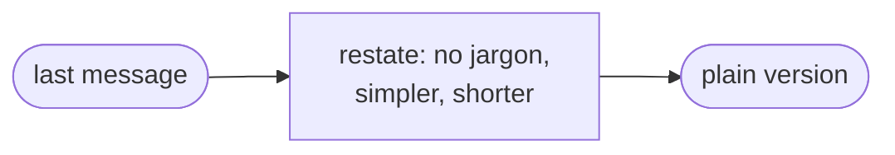
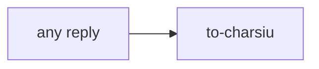

# to-charsiu

Restates the last message in plain human language. You call it; the model and the manager never do.

生舊叉燒好過生你: even Char Siu would understand it, so should you.

## DO IT

| Does | Detail |
| --- | --- |
| Restates | The last message with no jargon, simpler and shorter, like one person talking to another |
| Keeps | Every fact and number that mattered |

| Gives | Never |
| --- | --- |
| Plain restatement | Writes or changes a file, adds new content |

## USE IT

| Situation | Use |
| --- | --- |
| A reply was too technical | `to-charsiu` |
| You want a deeper explanation | ask a normal question |
| You want the work itself | the matching `go-*` skill |

## WORK IT

| Sign | Means |
| --- | --- |
| The restatement is shorter than the original | Simpler |
| No jargon is left | Plain |
| Numbers, names and decisions are unchanged | Facts kept |
| Nothing new is added | Faithful |
| No files change | Read-only |

## FIT IT

| Topic | What happens |
| --- | --- |
| Chain | It is standalone and sits in no chain |
| Use | After any skill, including `justaway` reports |
| Credit | Follows `bro` from cursor/plugins |
