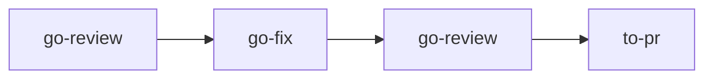

# to-pr

Writes the pull request title and body for the current branch. You call it; the model and the manager never do.

## DO IT

```mermaid
flowchart LR
    IN([branch diff vs base,<br/>your words, GLOSSARY.md]) --> T[one-line title]
    T --> B[body: Summary,<br/>Evidence, Merge Danger]
    B --> S[save pr-{base}.md]
    S -->|you ask| P([push, open PR])
```

| Step | Does |
| --- | --- |
| Reads | The branch diff against its base and what you tell it, plus `GLOSSARY.md` when present |
| Title | A one-line title in the project's commit format |
| Body | Summary (diagram, tree, pseudocode or diff), Evidence (before and after) and Merge Danger (door and blast radius) |
| Saves | `pr-{base}.md` in `~/.just-do-it/{project}/{branch}/`, updating in place; one file per target base |

| Gives | Never |
| --- | --- |
| `pr-{base}.md` | Pushes or opens the PR unless you ask |
| | Force-pushes |
| | Invents a result: no evidence reads `not run` |

## USE IT

| Situation | Use |
| --- | --- |
| Branch is done, you need the PR text | `to-pr` |
| Also open the PR | ask `to-pr` to open it |
| Check the code first | `go-review` |
| Needs `plan.md` or `review.md`? | No, it needs neither |

## WORK IT

| Sign | Means |
| --- | --- |
| The title is one line in the project's commit format | Title is right |
| Summary uses the smallest view that makes the point | Easy to read |
| Evidence shows before and after, or `not run` | Honest evidence |
| Merge Danger names a one-way or two-way door | Risk is named |
| `pr-{base}.md` exists at the branch folder path | Saved |
| Without an open request, nothing is pushed | Nothing leaves your machine |

## FIT IT



| Topic | What happens |
| --- | --- |
| When | You run it after the review is approved, outside the manager flow |
| No host CLI | It gives the new-PR URL and says the PR is not opened |
| Credit | Follows Matt Pocock's `pr`, from the `show-me` skill by Dex Horthy |
