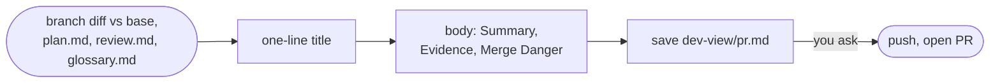

# to-pr

Writes the pull request title and body for the current branch and saves `dev-view/pr.md`. Opens the PR when asked.

## DO IT

| Step | Does |
| --- | --- |
| Reads | Branch diff against its base, `agent-view/plan.md`, `dev-view/review.md`, `dev-view/ut.md`, `dev-view/e2e.md`, and `public/glossary.md` when present |
| Title | One-line title in the project's commit format |
| Body | Summary (diagram, tree, pseudocode or diff), Evidence (before and after) and Merge Danger (door and blast radius) |
| Writes to storage | `~/.just-do-it/{project}/{branch}/dev-view/pr.md` |

[Skill](../skills/to-pr/SKILL.md) · [Storage](../skills/go-setup/references/storage.md)
