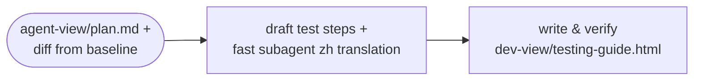

# to-test-doc

Writes the manual QA testing guide for a finished branch as a single-file interactive HTML QA page (`dev-view/testing-guide.html`) by default, or Markdown (`dev-view/testing-guide.md`) when you ask for `.md`.

## DO IT

| Step | Does |
| --- | --- |
| Default output | `dev-view/testing-guide.html` (or `dev-view/testing-guide.md` when you ask for `.md`) |
| Reads | `agent-view/plan.md`, `agent-view/research.md`, `public/glossary.md`, and branch diff |
| Low-token updates | Formats `const DATA` as multi-line JSON at the top of `<script>` so small changes only edit the changed lines |
| Translates (HTML) | A `fast` subagent adds `zh` using terms from repo i18n, `public/glossary.md`, and `agent-view/` |
| Verifies (HTML) | Checks the generated page per `verify.md` (`pass`, `fail`, or `not verified`) |

[Skill](../skills/to-test-doc/SKILL.md) · [Storage](../skills/go-setup/references/storage.md)
