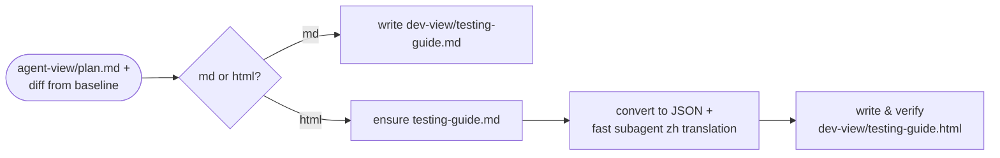

# to-test-doc

Writes the manual QA testing guide for a finished branch as Markdown (`dev-view/testing-guide.md`) or a single-file interactive HTML QA page (`dev-view/testing-guide.html`). Asks whether you want `md` or `html` (or both) when not specified.

## DO IT

| Step | Does |
| --- | --- |
| Asks | Format (`md`, `html`, or both) if not specified in the request |
| Reads | `agent-view/plan.md`, `agent-view/research.md`, `public/glossary.md`, and branch diff |
| Writes to storage | `dev-view/testing-guide.md` and/or `dev-view/testing-guide.html` |
| Translates (HTML) | A `fast` subagent adds `zh` using terms from repo i18n, `public/glossary.md`, and `agent-view/` |
| Verifies (HTML) | Checks the generated page per `verify.md` (`pass`, `fail`, or `not verified`) |

[Skill](../skills/to-test-doc/SKILL.md) · [Storage](../skills/go-setup/references/storage.md)
