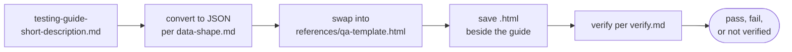
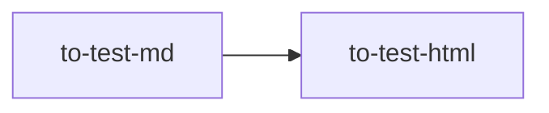

# to-test-html

Builds a single-file HTML QA page from the testing guide Markdown. You call it; the model and the manager never do.

## DO IT

| Step | Does |
| --- | --- |
| Reads | `testing-guide-{short-description}.md` in `~/.just-do-it/{project}/{branch}/` |
| Converts | To JSON per `data-shape.md`, and swaps that JSON into `references/qa-template.html` |
| Saves | `testing-guide-{short-description}.html` beside the guide, updating in place |
| Verifies | The page per `verify.md`, and reports `pass`, `fail` or `not verified` |
| No guide | Stops, writes nothing, and tells you to run `to-test-md` first |

| Gives | Never |
| --- | --- |
| The `.html` page and verify result | Hand-edits the page |
| | Writes a data or generator file |

## USE IT

| Situation | Use |
| --- | --- |
| Guide exists, testers want ticks and export | `to-test-html` |
| No guide yet | `to-test-md` first |
| Guide changed | edit the `.md`, rerun |

## WORK IT

| Sign | Means |
| --- | --- |
| The `.html` sits beside the guide and opens with no console error | Page works |
| Testers can tick steps, mark Pass or Fail, and export results with concerns | Usable for QA |
| Progress survives a reload | State kept |
| Language and Pass/Fail buttons are segmented controls, and links open in a new tab | UI as designed |
| Each `verify.md` check is reported honestly | Honest result |

## FIT IT

| Topic | What happens |
| --- | --- |
| Template | Previews on its own with a sample guide |
| When | Runs after the review is approved, outside the manager flow |
| `to-pr` | A separate step |
