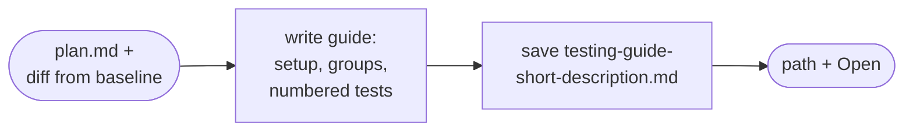
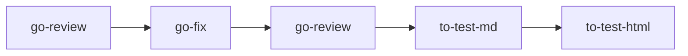

# to-test-md

Writes the manual testing guide as Markdown for a tester who knows nothing about the code. You call it; the model and the manager never do.

## DO IT

| Step | Does |
| --- | --- |
| Reads | `plan.md` and the diff from the plan's baseline; the ticket key and link come from the plan's `Requirement source` |
| Saves | `testing-guide-{short-description}.md` in `~/.just-do-it/{project}/{branch}/`, updating in place |
| Format | Setup, groups, numbered tests, one `Expect:` line each |
| Wording | Uses screen names, never file paths or component names |
| Returns | In `Open`: behaviours no test covers, and tests that cannot be done by hand |

| Gives | Never |
| --- | --- |
| The guide and `Open` list | Adds or drops a test without your answer |

## USE IT

| Situation | Use |
| --- | --- |
| Finished ticket needs test steps | `to-test-md` |
| You also want a clickable QA page | then `to-test-html` |
| Only the PR text | `to-pr` |
| No `plan.md` | It asks for it, or for requirements and the diff |

## WORK IT

| Sign | Means |
| --- | --- |
| Every acceptance criterion in `plan.md` has a test | Full coverage |
| Every step is 15 words or fewer, one action each | Easy to follow |
| Tests are grouped by purpose, with a one-line reason | Easy to scan |
| The reply gives the path and an `Open` list | Gaps visible |
| Re-running edits the same file | No duplicates |

## FIT IT

| Topic | What happens |
| --- | --- |
| `to-test-html` | Builds its page from this file |
| Linked tickets | It reads `Linked:` tickets from `state/triage.md`, saved by the manager |
| Position | Part of the user-run end of the flow, after `to-pr` |
