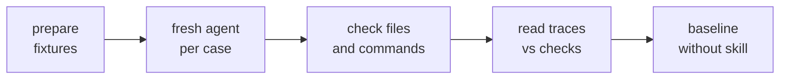

# Evals

Behavioral cases for the skills: file changes and executed commands, not just frontmatter and links.

## Run

| Step | Do |
| --- | --- |
| 1. Prepare | Disposable fixtures outside any real checkout (git repos, synthetic test runner, nothing installed): `python3 evals/fixture.py prepare /private/tmp/just-do-it-evals-UNIQUE` |
| 2. Run | Per case in `cases.json`, give a fresh agent only the skill path (from `skills/`, not an installed cache), the generated `request.txt` and the `repo` directory. It saves its final answer as `response.md` beside `repo`. Withhold `checks`, `before.json` and the fixture script |
| 3. Check | `python3 evals/fixture.py check /private/tmp/just-do-it-evals-UNIQUE` |
| 4. Read | Traces and responses against each case's `checks`. Flow cases: confirm `go-flow` dispatches the required workers, scopes their inputs, and writes outputs to `agent-view/` and `dev-view/` |
| 5. Baseline | Repeat without the skill. A case passing both ways may be redundant: shorten it unless it guards safety, approval or scope |

Run a subset with `--case CASE_ID` (repeatable) on `prepare` and `check`.

## Limits

| Limit | Detail |
| --- | --- |
| Synthetic runner | Logs arguments and file hashes per call, so it catches config or spec edits that narrow a run |
| Not covered | Real product tests, browser annotation delivery, tracker tools, or live model availability on every host |
| Failing focused command | Stays a reported failure |

For Brainstorm, check the worker count and timing in the trace. For pipeline resume, inspect launches and integration order; the checker also verifies the Git outputs. The annotation case passes the captured element identity as text and checks the file change and test-run boundary.
