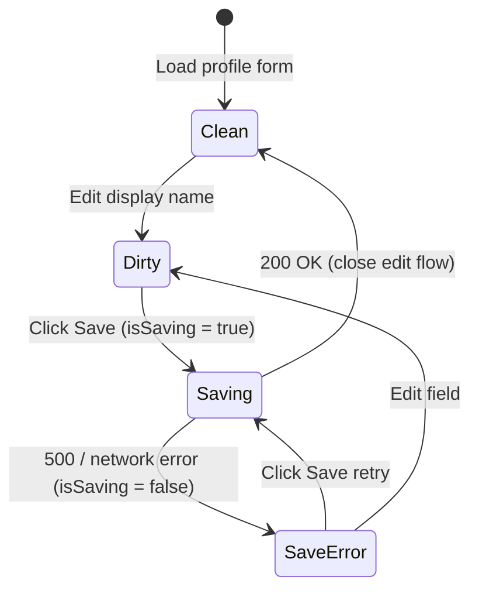

# Plan: PROJ-9999 Prevent duplicate profile saves

Status: example

## Goal

1. **Click Save on the profile form**\
   Expected: Send one `PUT /api/v1/profile` request, disable Save, and show `Saving...` while pending.\
   Actual: Save remains active when the request starts.
2. **Click Save again before the request completes**\
   Expected: Only the first click sends a save request.\
   Actual: Repeated clicks can send multiple requests.
3. **Save succeeds**\
   Expected: Close the edit flow and restore a clean form state.\
   Actual: Unverified.
4. **Save fails with a server or network error**\
   Expected: Show the error banner and re-enable Save for immediate retry.\
   Actual: Unverified.

## Statechart

- Invariant: `Saving` ignores duplicate `onSubmit()` calls and disables Save button.
- Invariant: `SaveError` clears `isSaving` and keeps server error banner visible.

## Implementation pipelines

| Pipeline | Ordered steps | Requires | Shared resources |
| --- | --- | --- | --- |
| Profile save | 1 | None | Existing ProfileForm fixtures |

## Steps

### 1. Guard Save while pending and recover on failure

- **Do:** Ignore `onSubmit()` calls while `isSaving` is true and disable the Save button (Save button states).
- **Do:** Clear `isSaving` on both success and failure while preserving the server error message.
- **Reuse:** `AppButtonComponent` (`[loading]="isSaving"`) and `AlertBannerComponent` for error display.
- **Test:** Repeated clicks send one request; failed save re-enables Save and shows error. Run: yes.
- **Commit:** `fix: prevent duplicate profile saves`
- **Blocked by:** none
- **Files:** Profile form logic, Profile form template, ProfileForm Unit Test; attachment: Save button states

## Out of scope

- Other forms outside ProfileFormComponent.

## Testing

- Seam: `ProfileFormComponent.onSubmit`. Catches duplicate calls and stuck disabled state; misses real network latency.
- E2E: Rapid double-click on Save submits once and recovers after a mocked 500 response.
- Prior art: ProfileForm Unit Test. E2E: Profile save E2E test

## Decisions

- Lock Save on the client via `isSaving` per ADR 001.
- Reuse `AppButtonComponent` and `AlertBannerComponent`.
- API contract and permissions unchanged.

## Deletions

None.

## Open

None.

## Reference

Requirement source: PROJ-9999 Repository: /example/repo Branch: PROJ-9999-prevent-duplicate-save Initial baseline: a1b2c3d Delivery: per-step commits
