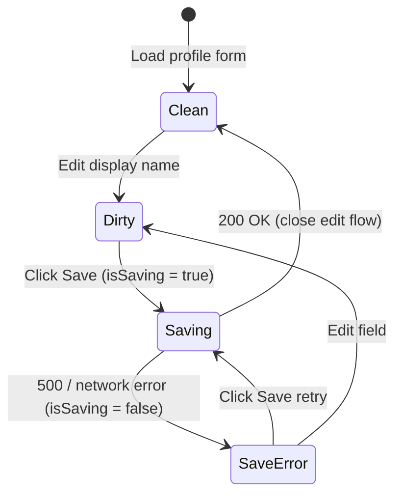

# Plan: PROJ-9999 Prevent duplicate profile saves

Status: approved

## Goal

Second Save click sends no request while the first is pending, and Save recovers on failure. `profile-form.component.spec.ts` and `profile-save.spec.ts` pass.

## Statechart

- Invariant: `Saving` ignores duplicate `onSubmit()` calls and disables Save button.
- Invariant: `SaveError` clears `isSaving` and keeps server error banner visible.

## Steps

### 1. Guard Save while pending and recover on failure

- **Do:** Ignore `onSubmit()` calls while `isSaving` is true and disable the Save button (`attachments/PROJ-9999/profile-save-states.svg`).
- **Do:** Clear `isSaving` on both success and failure while preserving the server error message.
- **Test:** Repeated clicks send one request; failed save re-enables Save and shows error. Run: yes.
- **Commit:** `fix: prevent duplicate profile saves`
- **Blocked by:** none
- **Files:** `src/app/profile/profile-form.component.ts`, `src/app/profile/profile-form.component.html`, `src/app/profile/profile-form.component.spec.ts`; attachment: `attachments/PROJ-9999/profile-save-states.svg`

## Acceptance criteria

### Saving

- First Save click submits one update.
- Repeated clicks submit nothing more while pending.
- Save stays disabled and shows `Saving...` during the request.

### After the request

- Success closes the edit flow.
- Failure shows the server error banner and re-enables Save for retry.

## Out of scope

- Other forms outside ProfileFormComponent.

## Testing

- Seam: `ProfileFormComponent.onSubmit`. Catches duplicate calls and stuck disabled state; misses real network latency.
- E2E: Rapid double-click on Save submits once and recovers after a mocked 500 response.
- Prior art: `src/app/profile/profile-form.component.spec.ts`. E2E: `playwright/tests/profile-save.spec.ts`

## Decisions

- Lock Save on the client via `isSaving` per ADR 001.
- API contract and permissions unchanged.

## Deletions

None.

## Open

None.

## Reference

Requirement source: PROJ-9999 Repository: /example/repo Branch: PROJ-9999-prevent-duplicate-save Initial baseline: a1b2c3d Delivery: per-step commits
