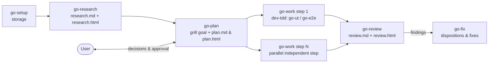

# Flow

Stateless pipeline orchestrator that chains the independent `go-*` skills over the shared branch directory `~/.just-do-it/{project}/{branch}/`. Every skill reads and writes its own files under `agent-view/` (compact `.md` for agents), `dev-view/` (human-readable `.html` by default), and `public/`.

## Pipeline

By default, run the full flow in order. When the user requests a partial chain (for example, `research -> plan` or `plan -> work -> review`) or when earlier artifacts already exist in `agent-view/` and the user asks to continue, start at the requested stage.

## Stage routing

| Stage | Skill | Execution | Storage output |
| --- | --- | --- | --- |
| 1. Setup | `go-setup` | Main thread | Confirms `{project}`; ensures `~/.just-do-it/{project}/{branch}/{agent-view,dev-view}` and `public/` |
| 2. Research | `go-research` | Fast worker | `agent-view/research.md`, `agent-view/attachments/{ticket}/`, `dev-view/research.html` |
| 3. Grill & plan | `go-plan` | Reasoning worker | `agent-view/plan.md`, `agent-view/checklist.md`, `agent-view/commit-format.md`, `agent-view/diagnose.md`, `dev-view/plan.html`, `public/glossary.md`, `public/adr/` |
| 4. Build & test | `go-work` | Standard worker per step (parallel when independent; calls `dev-tdd` -> `go-ut` / `go-e2e`) | Code & specs, `agent-view/checklist.md`, `agent-view/CHANGELOG.md`, `agent-view/ut.md`, `agent-view/e2e.md` |
| 5. Review | `go-review` | Main thread with review team | `agent-view/review.md` (references `agent-view/ut.md` & `agent-view/e2e.md`), `dev-view/review.html` |
| 6. Fix | `go-fix` | Main thread | Fixes, updates `agent-view/review.md`, `dev-view/review.html`, `agent-view/checklist.md`, `agent-view/CHANGELOG.md` |

## Flow execution

1. **Setup (`go-setup`).** Resolve `~/.just-do-it/*/{branch}`. If missing, run `go-setup` to confirm `{project}` with the user and create `agent-view/`, `dev-view/`, and `public/`.
2. **Research (`go-research`).** For a ticket key or requirements link, dispatch one `fast` worker per [agents.md](references/agents.md) with the resolved `{task}` path (`~/.just-do-it/{project}/{branch}/`). It fetches live requirements, comments, related tickets, and attachments, saving `agent-view/research.md`, `agent-view/attachments/{ticket}/`, and `dev-view/research.html`. Report any fetch/MCP failure immediately—never fall back to local git guesses. Skip if the user supplied full requirements inline with no lookup needed.
3. **Grill and plan (`go-plan`).** Dispatch one `reasoning` worker with `{task}`. Relay its numbered frontier questions (including goal confirmation, stateful transition checks, and any unknown domain terms for `public/glossary.md` or decisions for `public/adr/`) to the user and resume the worker with confirmed answers. Once `agent-view/plan.md`, `agent-view/checklist.md`, and `dev-view/plan.html` are written, share the `dev-view/plan.html` path and a short summary so the user can view `dev-view/plan.html` and approve the plan.
4. **Build (`go-work`).** After user approval, mark `agent-view/plan.md` and `dev-view/plan.html` `Status: approved`. If any step or the plan includes unit or E2E tests and `public/test-config.md` does not exist yet, run `go-setup`'s test-config confirmation first. Schedule ready steps per [reuse.md](references/reuse.md#parallel-steps):
   - Dispatch one `standard` `go-work` worker per ready step. Independent steps with disjoint writes and isolated tests run concurrently.
   - Each worker runs `dev-tdd` (calling `go-ut` / `go-e2e`, which write `agent-view/ut.md` / `agent-view/e2e.md`).
   - Verify each step's diff and test evidence per [reports.md](references/reports.md), serialize approved per-step commits, and ensure `agent-view/checklist.md` and `agent-view/CHANGELOG.md` are updated before unlocking dependent steps.
   - When the plan has a final E2E scenario not yet run inside a step, run `go-e2e` per [tests.md](references/tests.md) and [validation.md](references/validation.md) so `agent-view/e2e.md` is current.
5. **Review (`go-review`).** Run `go-review` on the branch diff against the plan's baseline and `agent-view/plan.md`. `go-review` writes `agent-view/review.md` (with references to `agent-view/ut.md` and `agent-view/e2e.md`) and `dev-view/review.html` (showing the UT/E2E pass/fail status badge).
6. **Fix (`go-fix`).** When `agent-view/review.md` has in-scope `TODO` findings under the approved plan (or selected by the user), run `go-fix` to apply fixes, update `agent-view/review.md`, `dev-view/review.html`, and `agent-view/CHANGELOG.md`, refresh affected tests in `agent-view/ut.md` / `agent-view/e2e.md`, and re-review delta changes through `go-review`.
7. **Finish.** Report the final status, saved file paths in `dev-view/` and `agent-view/`, and any open items. The user can run `to-pr`, `to-test-doc`, or `to-handoff` anytime.

## Authorization

- Follow the latest user instruction. Test runs, resets, commits, pushes, external writes, and scope expansion require authorization from the user or approved plan.
- Plan approval covers its listed steps, deletions, scoped test runs, per-step commit messages, and `go-fix` for in-scope findings.
