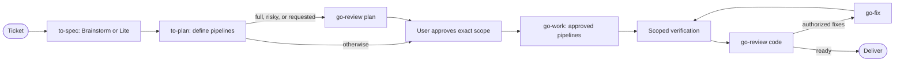

# Flow

Use shared task storage per [go-setup](../go-setup/SKILL.md). Coordinate in the current conversation. Honor a requested start, endpoint or mode. Before resuming, check matching task identity and artifacts; resolve missing prerequisites without running beyond the endpoint.

## Run in order

1. **Setup.** Resolve storage in the current thread. Use saved inputs only for the matching repository, branch and task.
2. **Spec.** Run [to-spec](../to-spec/SKILL.md) in the current conversation. Offer Brainstorm/Lite for ticket intake, use a selected mode, and follow the spec confirmation and blocked-source gates. For a spec endpoint, deliver the spec and stop. Resume planning only after a required confirmation.
3. **Draft.** Run [to-plan](../to-plan/SKILL.md) in the current conversation with the confirmed spec. Honor explicit short/full depth. Record the implementation pipelines, source precedents and acceptance tests. When full, risky or requested, run [go-review plan](../go-review/references/plan-review.md) and present the findings without changing the draft. Apply user-selected revisions through `to-plan` and repeat review when required for material changes. Before showing the final draft for approval, compute its [scope fingerprint](../to-plan/references/approval.md).
4. **Approve and build.** Record exact [approval](../to-plan/references/approval.md) and sync [progress](../to-plan/references/checklist-format.md#approval). Before testing, resolve missing test setup. Run the approved [pipelines](references/scheduling.md#approved-pipelines), inline for one and Standard workers for multiple. Keep TDD and the relevant focused tests with the pipeline owner.
5. **Verify.** Collect current unit/E2E results per [tests](references/tests.md), [validation](references/validation.md) and [reports](references/reports.md). Run integration verification inline by default; delegate only independently runnable suites with isolated resources. Update `ut.md` and `e2e.md`. Route failures to `go-work` within the configured retry limit. Required tests must pass before full delivery review.
6. **Code review.** Run [go-review code](../go-review/SKILL.md#code-review) against the integrated scope and current test evidence. At a review endpoint, return findings and stop. For full delivery, route authorized in-scope findings to `go-fix`. Recheck focused fixes, refresh stale required evidence and run a full delivery review on the final snapshot. Reuse a matching full review. Stop for exhausted retries, the review cap, or material changes requiring user input.
7. **Deliver.** State the actual endpoint, saved artifacts and open items. Full delivery requires passing required tests, verified acceptance and a current full review with zero open TODO findings. Report unchecked evidence honestly.

## Authorization

Use the latest user instruction. The exact approved scope covers its stated steps, deletions, test commands, commit groups and in-scope fix/review loop. Obtain renewed approval for scope or dependency changes. Pushes or external publication require explicit authorization. Honor test skips and uncommitted delivery.
