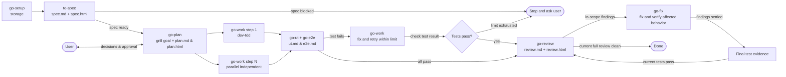

# Flow

Stateless pipeline orchestrator that chains ticket skills over the shared branch directory `~/.just-do-it/{project}/{branch}/`. Every skill reads and writes its own files under `agent-view/` (compact `.md` for agents), `dev-view/` (human-readable `.html` by default), and `public/`.

## Pipeline

By default, run the full flow in order. Start at the requested stage for a partial chain or a resumed run. Before dispatching later ticket stages, apply the [spec gate](../to-spec/SKILL.md#workflow) to the active ticket. If the spec is missing or blocked, resolve it through `to-spec` first.

## Stage routing

| Stage | Skill | Execution | Storage output |
| --- | --- | --- | --- |
| 1. Setup | `go-setup` | Main thread | Confirms `{project}`; ensures `~/.just-do-it/{project}/{branch}/{agent-view,dev-view}` and `public/` |
| 2. Spec | `to-spec` | Fast worker | `agent-view/spec.md`, `agent-view/attachments/{ticket}/`, `dev-view/spec.html` |
| 3. Grill & plan | `go-plan` | Reasoning worker | `agent-view/plan.md`, `agent-view/checklist.md`, `agent-view/commit-format.md`, `agent-view/diagnose.md`, `dev-view/plan.html`, `public/glossary.md`, `public/adr/` |
| 4. Build | `go-work` | Standard worker per step (parallel when independent; calls `dev-tdd`) | Code & specs, `agent-view/checklist.md`, `agent-view/CHANGELOG.md` |
| 5. Test | `go-ut` + `go-e2e` | Standard worker(s) | `agent-view/ut.md`, `agent-view/e2e.md`, `public/jdi-config.md` |
| 6. Review | `go-review` | Main thread with review team | `agent-view/review.md` (references `agent-view/ut.md` & `agent-view/e2e.md`), `dev-view/review.html` |
| 7. Fix loop | `go-fix` → `go-ut`/`go-e2e` → `go-review` | Main thread + test/review workers | Fixes, updates `agent-view/review.md`, `dev-view/review.html`, `agent-view/ut.md`, `agent-view/e2e.md`, `agent-view/checklist.md`, `agent-view/CHANGELOG.md` |

## Flow execution

1. **Setup (`go-setup`).** Resolve `~/.just-do-it/*/{branch}`. If missing, run `go-setup` to confirm `{project}` with the user and create `agent-view/`, `dev-view/`, and `public/`.
2. **Spec (`to-spec`).** For a ticket key or requirements link, dispatch one `fast` worker per [agents.md](references/agents.md) with the resolved `{task}` path (`~/.just-do-it/{project}/{branch}/`). Wait for its result. Proceed only with a ready spec or complete requirements supplied inline. Follow [Blocked spec](../to-spec/SKILL.md#blocked-spec) for a failed lookup, partial spec, or missing worker result. Apply the same gate when resuming a later ticket stage whose spec is blocked.
3. **Grill and plan (`go-plan`).** Dispatch a `reasoning` worker for each planning round with `{task}`, confirmed answers, and open questions. Present the returned questions in the [`go-plan` terminal format](../go-plan/SKILL.md#1-grill). Once `agent-view/plan.md`, `agent-view/checklist.md`, and `dev-view/plan.html` are written, share the `dev-view/plan.html` path and a short summary for approval.
4. **Build (`go-work`).** After user approval, mark `agent-view/plan.md` and `dev-view/plan.html` `Status: approved` and [sync the checklist](../go-plan/references/checklist-format.md#approval) before dispatch. If any step or the plan includes unit or E2E tests and `public/jdi-config.md` does not exist yet, run `go-setup`'s configuration confirmation first. Schedule ready steps per [scheduling.md](references/scheduling.md#parallel-steps):
   - Dispatch one `standard` `go-work` worker per ready step in its own worktree. Group the same feature or function in one step. Overlapping files alone do not prevent parallel work.
   - Each worker runs `dev-tdd` (writing complete unit specs for the touched component/unit via `go-ut`).
   - Verify each step's diff and test evidence per [reports.md](references/reports.md), integrate its approved commit groups, then update `agent-view/checklist.md` and `agent-view/CHANGELOG.md` before unlocking dependent steps. For explicit uncommitted delivery follow the scheduling exception.
5. **Test (`go-ut` + `go-e2e`).** Before entering review, verify all changed unit specs through `go-ut` in evidence-only mode and publish `agent-view/ut.md` from those results and run planned E2E scenarios through `go-e2e` (writing `agent-view/e2e.md`) per [tests.md](references/tests.md) and [validation.md](references/validation.md). Route failed tests to `go-work` and apply the project's [test retry limit](../go-setup/references/public-docs.md#jdi-configmd), including failures after review fixes. Do not start or resume review while required tests fail.
6. **Initial full review (`go-review`).** Review the current diff from the plan's baseline against the approved outcomes, with current test evidence. If that full review clears the delivery criteria in step 7, finish without dispatching another pass.
7. **Focused fixes and delivery review.** Run this stage only when the requested flow includes the fix loop. If it ends at review, return the findings.
   - Send in-scope `TODO` findings to `go-fix` in batches. Until those findings are settled, check the fixes and run only affected authorized tests. Keep the last full-review snapshot and round.
   - At delivery, refresh required test evidence that is missing or stale on the current snapshot. Once required tests pass, use `go-review` for a full review of that snapshot. Reuse an existing matching full review per `go-review`. New in-scope findings return to focused fixes.
   - Finish when the current snapshot has a complete full review, required tests pass, required acceptance outcomes are verified, and 0 `TODO` findings remain. If the review cap or a test retry limit blocks progress, stop and ask the user. Report skipped checks and unresolved evidence without claiming verified completion.
8. **Finish.** Report the final status, saved file paths in `dev-view/` and `agent-view/`, and any open items. The user can run `to-pr`, `to-test-doc`, or `to-handoff` anytime.

## Authorization

- Follow the latest user instruction. Test runs, resets, commits, pushes, external writes, and scope expansion require authorization from the user or approved plan.
- Plan approval covers its listed steps, deletions, scoped test runs, per-step commit messages, and the `go-fix` → re-test → re-review loop for in-scope findings.
