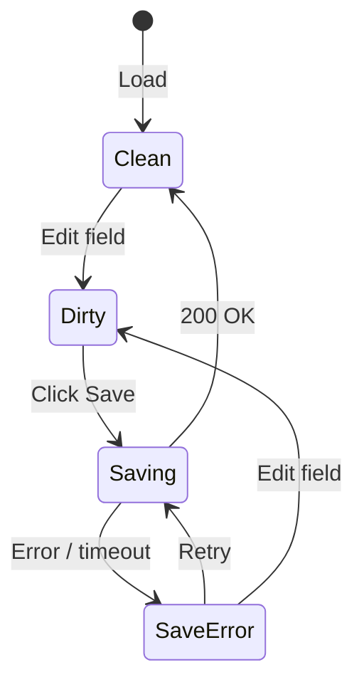

# Statechart (`go-plan`)

Use when a ticket introduces or modifies **stateful behavior**: UI/form lifecycles (`Clean -> Dirty -> Saving -> Error`), multi-step wizards, tab switches with unsaved drafts, async request/retry flows, or business status transitions (`Draft -> Submitted -> Approved`). Skip for static layout, copy/i18n-only, or simple configuration changes.

## 1. Extract the state machine

Identify from code and requirements:

- **States**: distinct modes the user or record can be in (for example, `Clean`, `Dirty`, `Saving`, `SaveError`, `ConfirmLeave`).
- **Transitions**: `From State --[Event / Guard]--> To State` (user actions, API responses, timeouts, navigation).
- **Invariants**: rules that must hold in or across states (no duplicate submit while `Saving`, no stuck disabled button on error, no silent data loss on tab switch).

## 2. Probe for missing transitions & dead ends

Check every state against four failure lenses before writing steps:

1. **Async exit completeness**: does every loading/saving state transition out on both success AND error/timeout?
2. **Recovery from error**: can the user retry, edit, or cancel from every error state without refreshing the page?
3. **Duplicate / concurrent events**: what happens on double-click submit or rapid tab/patient switch while a request is in flight?
4. **Dirty-state navigation**: what happens when the user switches sections (for example, Section B to Section C) or closes a drawer with unsaved edits?

If any transition is unspecified in the ticket, ask the user during `Grill`.

## 3. Record in `agent-view/plan.md` and `dev-view/plan.html`

- In `agent-view/plan.md`, add a compact `## Statechart` section after `## Goal` with a Mermaid `stateDiagram-v2` block and one-line invariant bullets so `go-work` tests and implements every transition:

```markdown
## Statechart



- Invariant: `Saving` blocks duplicate submit; `SaveError` re-enables Save/Retry.
```

- In `dev-view/plan.html`, render the statechart diagram and invariant table visually per [`html-render.md`](../../go-setup/references/html-render.md) so the user can verify all transitions before approving the plan.
